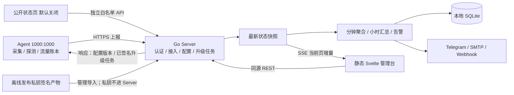

# OrbitBeacon 设计实施方案

## Context
开发一个类似 ServerStatus-Rust 的全球多 VPS 探针系统，重点是快速查看状态、集中管理、跨架构/系统快速接入、Docker 与原生二进制部署，以及现代、简洁、易操作的中文 UI。目标为自托管自用/小团队的 10–500 台节点，Linux 为主并兼容 Windows/macOS；服务端和客户端均以轻量、低资源、少依赖为硬约束。用户要求原生 Agent 支持网页远程升级，客户端启动和运行默认 `1000:1000`，只有安装需要 sudo；不提供远程终端、任意命令或文件管理。

原始方案基于空目录假设；现已在实际仓库核对并继续开发。实施现状、已验证与未验证范围见下表；后文未勾选能力仍是目标契约，不能据此认定已经实现。

## 实施进度（2026-10-27 最终验收）

|步骤|状态|证据与缺口|
|---|---|---|
|1. 单仓、静态交付与身份控制面|后端已交付；静态技术栈部分完成|已有提交 `2fb224c`；用户/会话/权限/分组/节点/审计真实实现。当前为内嵌原生 HTML/JS，不是方案要求的 Svelte/type generation，留在步骤5完成。|
|2. 接入、采集、上报与配置|核心闭环已实现并完成本轮修复验证|真实短期令牌/重试/轮换，非root Agent enroll/doctor/run，来源质量、generation/session/seq、远程配置确认。修复存储祖先权限、轮换后fence恢复、首报绑定、跨进程配置回退、被fence旧进程退出。首次立即采集已实现；固定随机相位、静态信息仅变化传输仍未实现，不能标整步完成。|
|3. 可信状态、历史和月流量|未实现|当前 enrolled inventory 保持 unknown；无在线离线单调计时、聚合/查询/账本/流量ack；普通上报仍逐次写事务。下一切片应先完成可信连接状态与脱敏最新指标读取，再做存储writer/历史和月流量。|
|4. 安装与平台|部署材料基础已交付；安装器与平台验收未实现|已交付 `deploy/` 的 systemd、容器、Compose、healthcheck 与 verify-bundle 配置；仍无跨平台安装器、Agent服务安装和平台实机验收。|
|5. 完整管理UI|未实现|基础控制台可用，本轮修复 `_app` 未嵌入导致登录JS 404；文案由真实 `omp --model designer` 设计并review通过；无接入向导、监控指标/SSE/图表/完整中文主题UI。|
|6. 探测与告警|未实现|无真实探测/告警/通知闭环。|
|7. 签名升级|未实现|update 命令明确拒绝，不把预建表当升级功能。|
|8. 备份诊断及最终验收|基础命令与健康检查已交付；最终验收未完成|Agent doctor、health/readiness、verify-bundle、锁定的 `backup`/隔离 `restore` 已实现并有针对性测试；完整归档包、资源预算、断电/跨平台/空目录接回验收仍未交付。|

本轮验证通过：`go test ./...`、`go vet ./...`；现有Go1.27容器提供gcc，执行 `CGO_ENABLED=1 go test -race ./internal/server/... ./internal/agent/...` 全通过（源码与module cache只读挂载）。Go真实二进制+本地CA HTTPS完成bootstrap→API建节点/令牌→Agent enroll/doctor/run→配置revision确认→无票据恢复→运行中轮换及旧凭据401；再启动新generation，旧Agent退出1；root运行doctor被拒绝。Agent在可销毁容器中显式UID/GID=1001:1001，policy/CA仅容器内管理员持有，不等同默认1000:1000或Docker宿主范围验收。现有Docker Chromium实际登录→创建pending→详情改配置→深链接刷新，1440浅色/390深色截图；移动端无整页横向溢出、无JS控制台错误，键盘Tab和退出可用。未安装Playwright。临时Server/Agent/Chromium及测试容器已停止，现有服务未改动。

已确认偏差：项目许可证保留仓库现有 GPL-3.0；直接 Go 依赖及 modernc 传递通知基线见 `THIRD_PARTY_LICENSES.md`，不把参考项目许可证延伸到本项目；SQLite driver 使用可用的 v1.61.0，不写成 v1.61.1。完整平台运行、500节点资源预算、升级/断电恢复、公开隐私、完整归档备份及跨空目录 Agent 接回仍未验证；O16 仅证明本地一致性快照与隔离恢复路径。

最终回归与关键场景证据见 `ACCEPTANCE.md`：全量测试、vet、模块校验、固定 Go 1.27.3 容器竞态、双端构建、真实 Server readiness、systemd 实路径校验、Compose 配置和 distroless nonroot 容器健康运行均通过；主机直接 race 因缺少 gcc 在编译阶段失败，已在固定 Go 容器内完成。跨平台实机、资源预算、升级断电、完整归档备份、公开隐私和完整依赖法律扫描仍保持未验收状态。

## 项目命名与调研结论

采用 **OrbitBeacon**，仓库短名 `orbitbeacon`，二进制 `orbitbeacon-server`、`orbitbeacon-agent`。Orbit 的轨道意象对应分布各地的节点，Beacon 的信标意象对应持续上报的状态。本次更名尚未核查新名称在 GitHub、域名或商标等渠道的可用性。

四个只读 subagent 分别调查参考实现、同类产品、跨平台/容器、管理 UI。采用原创控制面、协议和 UI，复用成熟基础库；不 fork 整套产品，也不复制授权不明的前端。

|研究对象|核实结果及来源|采用的模式 / 不照搬的部分|
|---|---|---|
|[ServerStatus-Rust](https://github.com/zdz/ServerStatus-Rust)|正式版 v1.8.1；源码研究基线 master `485b2ddaa65da738ed456e09fdb16522e16b5b63`，不等同于发行版。Apache-2.0。主动 HTTP/gRPC 上报、分组注册、基础指标和通知；[stats.rs](https://github.com/zdz/ServerStatus-Rust/blob/485b2ddaa65da738ed456e09fdb16522e16b5b63/server/src/stats.rs)是最新状态及周期快照，不是历史查询存储。|借鉴单文件、主动连接、紧凑总览。重新实现资产 CRUD、独立节点身份、历史与生命周期；不复制组共享长期密码、离线自动删除、秒级 shell 采集。|
|[Nezha](https://github.com/nezhahq/nezha)|Dashboard v2.5.0、Agent v2.4.0；WTFPL v2。[安装](https://nezha.wiki/guide/agent.html)、[认证](https://github.com/nezhahq/nezha/blob/master/service/rpc/auth.go)、[告警](https://github.com/nezhahq/nezha/blob/master/model/alertrule.go)。|借鉴平台安装菜单、逐节点批量结果、持续时间告警。不继承终端/任务控制面和多套协议。|
|[Komari](https://github.com/komari-monitor/komari)|Server 1.6.0、Agent 1.5.11，二者 MIT；[注册凭据换节点凭据](https://github.com/komari-monitor/komari/blob/main/web/api/client/autoDiscovery.go)。官方前端 `radix` 分支本次未找到明确项目许可证，不能把后端 MIT 自动延伸到 UI。|借鉴自动注册、独立节点 token、静态 UI 内嵌；不复制前端代码或引入 JavaScript 插件执行器。|
|[Beszel](https://github.com/henrygd/beszel)|v0.21.1，MIT；Hub 内嵌 PocketBase/SQLite。[接入](https://beszel.dev/guide/getting-started)、[安装限制](https://beszel.dev/guide/agent-installation)、[实时 worker](https://github.com/henrygd/beszel/blob/main/internal/hub/systems/system_realtime.go)。|借鉴 Docker/二进制统一向导、能力提示、有限历史。无需引入完整 PocketBase 模型，也不建立订阅时额外向 Agent 拉取的第二条采集路径。|

“未发现”不是安全审计结论；项目本身遵循仓库 GPL-3.0，直接及传递依赖的许可证和通知按 `THIRD_PARTY_LICENSES.md` 基线维护。参考项目许可证只描述上游，不自动兼容或延伸到本项目；不复制其代码或授权不明的前端。

## 技术选型与架构

|层|确定选型|理由与取舍|
|---|---|---|
|Server / Agent|Go 1.27.3，标准库 `net/http`、`slog`、`crypto`；Agent 使用 gopsutil v4.26.9|统一语言和发布链，成熟跨平台采集。Rust 可降低部分运行时基线，但本次未实测，不能据此声称 Go 最省内存；用明确资源门禁约束。|
|数据库|`database/sql` + `modernc.org/sqlite` v1.61.0|单本地数据库，无 CGO、无 ORM、无独立数据库服务。只进入 Server 依赖图。版本以 `go.mod`/`go.sum` 为准；modernc 的 SQLite 与传递第三方通知按许可证基线保留。|
|浏览器 UI|目标基线：Svelte 5.57.2、SvelteKit 3.1.0、adapter-static 4.0.0、Vite 8、TypeScript 6；Bits UI按需引入Dialog/Dropdown/Tabs；原生表格、CSS tokens、uPlot懒加载|目标前端尚未进入当前仓库，不能把这些版本、构建产物或许可证视为已交付依赖；进入 `web/` 前重新锁定版本、peer约束和许可证通知。|
|开发期|目标基线：Node 24 LTS、npm lockfile；当前后端仅使用 Go module|只有依赖实际进入仓库并生成 lockfile 后才执行对应 npm 构建/许可证检查；不以方案版本替代现有实现状态。|
|通信|Agent 主动 HTTPS JSON POST；管理 API 同源 REST；浏览器一个 SSE 连接|穿透 NAT/常规反向代理，只开放服务端端口；不同时维护 gRPC/WebSocket。小 JSON 的维护成本低于自定义二进制协议，限制报文大小并复用 TLS 连接。|
|部署|Linux Server amd64/arm64 二进制及 Docker；Agent 平台矩阵见下文|单 Server 进程、每节点单 Agent 稳态进程；仅升级窗口允许同身份临时辅助进程。|
|扩展|按采集、探测、通知、更新划分包；版本化 HTTP/OpenAPI + Webhook|平台差异使用编译标签，渠道差异限制在通知包；出现第二个具体实现时再提取最小接口，不预建插件 ABI、脚本 runtime、多租户、集群或通用任务队列。|

依据：[Go 版本](https://go.dev/doc/devel/release)、[gopsutil](https://github.com/shirou/gopsutil/tree/v4.26.9)、[现代 SQLite 驱动](https://gitlab.com/cznic/sqlite/-/raw/master/CHANGELOG.md)、[SQLite WAL](https://www.sqlite.org/wal.html)、[Svelte](https://svelte.dev/docs/svelte/overview)、[静态 SPA](https://svelte.dev/docs/kit/single-page-apps)、[Bits UI](https://bits-ui.com/docs/introduction)、[uPlot](https://github.com/leeoniya/uPlot)、[Node LTS](https://nodejs.org/en/about/previous-releases)。SQLite 必须包含 WAL-reset 修复（上游 3.51.3+）；所选驱动已包含更高版本。

### 轻量化默认值与资源预算

这些是必须测量的**交付目标，不是已证明的数字**。不通过时优化真实热点，不静默降低功能或更改频率冒充达标。

|项目|默认值/验收预算|
|---|---|
|基础 CPU/内存/swap/网络采集和上报|同一个 10 秒周期，首次立即采集后进入固定随机相位；节能档 30 秒；最小 5 秒。单个在途上报，连接复用。|
|磁盘容量 / 静态信息|60 秒 / 启动和每 6 小时；静态信息仅变化时再传。慢采集有独立时间戳。|
|网络探测|默认没有任务；创建后默认 60 秒、超时 3 秒、每节点最多 5 个目标、并发 2。|
|历史|1分钟聚合保留24小时；1小时聚合保留30天。实时只保留每节点最新状态和分钟聚合器，不另存没有消费接口的秒级环形历史。|
|Agent 稳态资源|Linux amd64/arm64：RSS ≤25 MiB，平均 CPU ≤单核 0.5%；单节点默认上报双向应用层流量 ≤25 MiB/天；默认日志+状态逻辑写入 ≤5 MiB/天，升级包不计。逻辑写入按实际write字节累计；文件系统块写入、日志和fsync放大另测并报告，不能混作同一预算。Windows/macOS RSS 目标 ≤40 MiB，单独报告系统采集成本。|
|Server 稳态资源|50 节点、1 个浏览器：RSS ≤96 MiB；500 节点、5 个浏览器：RSS ≤192 MiB、平均 CPU ≤单核 15%；500 节点长期保留上限下基础历史+索引 ≤1 GiB，无探测任务时测量。存储预算取正常checkpoint后的运行数据库，不用VACUUM后的紧凑备份冒充；WAL峰值另报。|
|资源测试条件|正式优化构建，Linux amd64 2 vCPU/2 GiB/本地 SSD，预热 5 分钟、测量 30 分钟；另测 1 vCPU/512 MiB 下 50 节点。明确 CPU 为进程 CPU 时间/墙钟时间，不用多核平均掩盖开销。|
|前端|总览首屏 JS+CSS gzip ≤200 KiB；图表进入详情才下载；表格最多 100 行/页，默认 50；不逐行创建图表，不动画刷新数值。|

500 节点/10 秒是平均 50 次上报/秒；一分钟一行是 72 万行/天。24 小时分钟数据加 30 天小时数据最多约 108 万节点桶；这是算术，不是数据库字节数或吞吐实测。原生运行是低配机器首选，不要求为探针安装 Docker。

## Approach

按依赖顺序交付可运行的纵向切片：步骤 1（身份/存储/协议基础）→步骤 2（真实接入与采集）→步骤 3（可信状态、历史和账本）。步骤 4 的平台安装材料与步骤 5 的静态 UI 壳只能在协议稳定后并行；UI 的实时指标、历史和配置页面仍依赖步骤 3。步骤 6 探测告警依赖步骤 2–3 的采集与历史，步骤 7 签名升级还依赖步骤 4 的服务托管、发布清单和可回滚状态。步骤 8 的 health、verify-bundle、备份恢复可提前交付基础命令，但完整归档包、故障注入和最终验收必须放在相应存储/升级契约完成后；每步接入真实实现，不以固定数据、空 API 或伪成功按钮占位。

### 1. 建立单仓、静态交付与身份控制面

创建 `go.mod`（模块名 `orbitbeacon`，仓库未发布时不假定组织域名）、`cmd/orbitbeacon-server/main.go`、`cmd/orbitbeacon-agent/main.go`。业务放在 `internal/server/{auth,nodes,ingest,history,alerts,updates}`、`internal/agent/{collect,probe,traffic,update,service}`；共用 DTO 在 `internal/protocol/v1`。`web/` 是独立 npm 工程，构建至 `internal/server/webui/dist/` 后 `go:embed`；API/静态资源未知路径返回真实 404，仅已定义 UI 路由回退至 `200.html`。

创建 `api/openapi.yaml` 为 wire contract；Go DTO 与 OpenAPI 对齐，前端用 `openapi-typescript` 生成类型，不重复手写结构。API 错误统一 `{code,message,request_id,fields?}`；ID 使用 UUID，时间使用 UTC RFC3339，指标单位在下一节固定。配置文件 JSON；普通配置按 CLI flag > 环境变量 > 配置文件 > 默认值，受保护安装policy固定的身份、信任锚、origin和路径不参与覆盖，冲突直接拒绝。运行期远程配置只能覆盖明确的采集/探测字段，不能改服务地址、信任公钥、身份、目录、代理或运行账户。

Server 命令：`orbitbeacon-server serve --config <file>`、`bootstrap --data-dir <dir>`、`backup --config <file> --output <file>`、`restore --data-dir <dir> --input <file>`。bootstrap 仅本机交互创建首个管理员，密码从 TTY/标准输入读取，拒绝已有管理员覆盖；没有公网“抢注首个管理员”接口。serve 默认 `127.0.0.1:8080`，容器显式 `0.0.0.0:8080`；有证书时可通过 `tls_cert_file`/`tls_key_file` 在 8443 原生 TLS，或接现有 TLS 反向代理。生产 Agent 只允许 HTTPS；`--allow-insecure-localhost` 只允许回环地址的开发环境，不能关闭任意地址 TLS 校验。

用户角色只设 `admin`、`viewer`，均可查看私有监控；viewer 不能改配置、看 secret、发行接入令牌或升级。管理员管理用户、分组、标签、节点备注/地区/提供商，不做租户隔离。密码使用 `golang.org/x/crypto/argon2` Argon2id（32 MiB、t=2、p=1；登录计算并发 1），登录限速；随机会话 token 只存 SHA-256，Cookie HttpOnly/SameSite=Lax/Secure，12 小时失效，修改密码撤销旧会话。变更请求校验 Origin 和 CSRF token；会话退出/权限变更关闭相应 SSE。通知 secret 用安装时生成的 32-byte `secrets.key` 经 AES-GCM 加密，该 key 不进数据库、不写日志。

基础表：`users`、`sessions`、`nodes`、`groups`、`node_tags`、`enrollment_tokens`、`enrollment_claims`、`settings`、`audit_events`、`schema_migrations`。`nodes` 持久保存名称、分组、地区、备注、独立 token_hash、安装 ID、首次接入时间、最后持久心跳、静态信息、期望/已应用配置版本和公开设置；标签单独关系表。首次接入后的资产**不因离线自动删除**。删除节点要求确认并在同一事务撤销凭据、取消待执行升级，关联历史分批删除；重装用专用重置接入流程，不匹配 hostname 猜节点。

管理路由前缀 `/api/v1`：`/session` 登录/退出，`/me`，`/users`，`/nodes`、`/nodes/{id}`，`/groups`，`/enrollments`、`/enrollments/{id}`，`/nodes/{id}/config`，`/nodes/batch`，`/audit`。批量请求必须是显式 ID 列表（最多 500），返回 `results:[{node_id,status,error_code?}]`，不能只返回统一成功。分组配置复制到节点时产生节点配置新版本，不做多级继承优先级。

其余API在对应步骤实现：`GET/PATCH /api/v1/settings`；`GET/POST/PATCH/DELETE /api/v1/probes[/{id}]`、`/alert-rules[/{id}]`、`/notification-channels[/{id}]`；`POST /api/v1/notification-channels/{id}/test`；`GET /api/v1/alerts`、`POST /api/v1/silences`；`GET /api/v1/releases`、`POST /api/v1/update-jobs`、`GET /api/v1/update-jobs/{id}`；`GET/PATCH /api/v1/public-settings`。集合GET/POST与单项GET/PATCH/DELETE只实现适用方法；不支持的方法405。管理修改需admin，GET返回脱敏DTO；update-jobs请求固定`{release_seq,node_ids}`，创建202返回`{job_id,results}`。这些API不得与Agent认证混用。

配置键固定：Server `listen_addr,data_dir,public_url,tls_cert_file,tls_key_file,trusted_proxy_cidrs,max_nodes`，max_nodes默认500、正整数；预建pending和批量注册均在事务内检查节点总数，容量不足409 `node_capacity_reached`，disabled节点也占额。显式调高只改变接入上限，不表示更高规模已达资源预算。Agent不可远程修改的安装配置 `server_url,ca_file,state_dir,runtime_dir,expected_uid,expected_gid,install_mode,trust_key_file`，Windows用`expected_account`替代uid/gid。Agent可远程修改的`DesiredConfig`为`{revision,report_interval_seconds,disk_interval_seconds,interfaces,disk_paths,probe_targets,billing_day,quota_bytes}`，interval范围5–60、disk范围60–3600、billing_day范围1–28；每字段错误在400的fields中返回，不静默截断。CLI/环境配置不接受任意URI作为DB路径。根`/`按会话跳转overview/login，public_url必须绝对HTTPS、不带userinfo/query，安装模板只使用该配置，不信任请求Host头。

### 2. 打通短期接入、真实采集、上报与集中配置

接入向导先预建 `pending` 节点，再生成有效期 15 分钟、单次使用且绑定节点的 256-bit enrollment token；批量模式创建绑定分组、30 分钟、最多 100 次的 token。后台只存哈希；只在创建时显示原文，URL/日志不携带 secret。

Agent首次安装生成并原子保存`installation_id`与随机256-bit `node_token`，再以enrollment token为Authorization Bearer调用`POST /api/agent/v1/enroll`，body为`{protocol_version:1,installation_id,node_token,system}`。Server事务内绑定节点、保存node_token哈希、扣减名额；同一enrollment+installation_id+相同token重试返回原绑定、不重复占额。首次认领必须在15/30分钟有效期内，已成功认领的完全相同请求可在首次成功后24小时内重试，即使票据自然过期；显式撤销则立即阻止所有重试。不同secret/节点绑定冲突409 `enrollment_conflict`。客户端先落盘身份再请求，避免响应丢失导致重复资产；恢复时优先用已生成node_token尝试report，成功即完成登记，不需要保存短期票据。

上报固定 `POST /api/agent/v1/report`，Bearer 为每节点 token；**服务端从认证结果决定节点 ID**，body 不接受可改写目标的 node_id/gid。撤销凭据立即 401；禁止节点写管理 API。协议不支持返回 426 `protocol_unsupported`，非法字段/NaN/越界 400，不更新时间戳，不返回假成功。请求体上限 64 KiB，每节点平均最多 1 请求/秒、突发 3。

`Report`固定字段：`protocol_version,run_generation,session_id,seq,sampled_at,config_revision,system?,metrics,capabilities?,traffic,probe_results?,update_status?`。`run_generation`持久保存在identity，每个新的采集主进程启动前原子+1（自检/watch不增加）；Server持久保存当前generation和session_id。较低generation拒绝，同generation不同session_id返回409 `identity_conflict`，较高generation提交后替换当前session。普通请求重试不产生新generation。seq仅做本次Server运行期实时去重：同session重复/乱序返回已接受seq，不更新latest/last_seen/聚合；不为跨崩溃exactly-once每条写库。该机制拒绝旧进程报文，但不声称能检测所有持有同一身份文件的克隆；clone必须重新enroll。

`metrics` 包含整体 `cpu_percent`、`load1/load5/load15`、`memory_total_bytes/available_bytes`、`swap_total_bytes/used_bytes`、选定磁盘 `{path,total_bytes,used_bytes,sampled_at}`、选定网卡 `{name,rx_bytes_per_sec,tx_bytes_per_sec}`、`uptime_seconds`。百分比 0–100，容量 bytes，速率 bytes/s，负载不当作百分比；总体内存使用率统一 `(total-available)/total`，不跨平台假定“used”口径相同。无法采集值为 null，附 `metric_status`：`ok|unsupported|permission_denied|disabled|error|stale`，不能用 0 伪装。大流量累计 `rx_bytes/tx_bytes` 在 JSON 用十进制字符串避免 JS 精度丢失。

每项来源带`sample_id,age_ms,source_interval_ms`，差分指标另有`measurement_window_ms`；age与window由Agent单调时钟生成，sampled_at只供展示。相同sample_id不增加历史有效次数、探测失败计数或告警恢复计数；新鲜度上限`max(3×source_interval_ms,45000)`。基础/磁盘/macOS网络不同频率均按真实来源判断，不能把10秒重复上报的60秒磁盘读数当6个新样本。历史覆盖率是采样覆盖估算，不是持续观测证明。disk/net配置变更携带`config_revision`，历史按path/interface标识分系列，不能把不同盘的百分比混算。

使用 gopsutil v4 按模块读取，不导入 process/docker/sensors 全量路径；CPU 与网速保存前次计数和单调时钟做非阻塞差分，首次显示“采样中”。默认根盘 `/`（Windows 系统盘），可选择最多 8 个本地挂载点；默认选择首个可用默认路由网卡并在 UI 明示，允许明确指定最多 8 个接口，不把 bridge/veth/loopback 与外网接口重复加总。根盘与网卡选择失败要显示需要配置，不猜零值。静态主机信息不含系统账户、进程或环境变量。

Linux/Windows 基础采集不运行shell。macOS gopsutil v4.26.9网络计数使用系统netstat，接口名截断时还可能调用ifconfig，这是已知平台差异：独立30秒采集并复用带真实时间戳的结果，不宣传全平台“零外部进程”。服务启动环境固定PATH=`/usr/bin:/bin:/usr/sbin:/sbin`，全部为系统目录；采集context超时3秒、无shell拼接，权限不足仍保持其他采集运行。

报告响应`{accepted_seq,server_time,desired_config?,update_job?,traffic_acks?}`；accepted_seq只表示实时接受，非历史持久保证。`traffic_acks:[{epoch,period_start,rx_bytes,tx_bytes}]`只来自已提交SQLite的high-water，不提前确认；所有累计为十进制字符串。配置revision单调递增，Agent校验后原子保存应用、下次报告确认；失败报`config_error`并保留上一版本，UI显示待应用/成功/拒绝。凭据轮换使用新的节点绑定enrollment，成功替换旧凭据失效；不下发通用文件或命令。

一个采集调度循环按各项到期时间更新最新状态；另一个固定上报worker通过容量1的通知通道读取最新快照，始终只有一个在途请求。网络退避不得让采集/流量累计停转，旧通知可以覆盖但不积压；不创建每项指标常驻线程。使用一个复用HTTP client，连接/请求超时5秒；失败1/2/4/8/…/60秒指数退避加20%抖动。429/503的Retry-After限制在1–300秒；401按60秒复查并显示凭据错误。断网不堆积任务/离线历史库，常规成功不逐次打日志。

### 3. 实现可信状态、有限历史和月流量

连接状态`pending|online|offline|unknown|disabled`与指标质量分开。通过认证/结构校验/generation及seq去重的新报告才刷新last_seen；全部指标null仍可连接online。超时阈值为`max(45秒,3×Agent已确认应用的report_interval_seconds)`，不根据网络退避或到达间隔扩大。运行期使用Server单调时钟，UTC仅持久/展示。Server启动后曾接入节点unknown，等待同样宽限期再判offline；pending不告警，disabled仍可接收只用于配置/版本确认的报告但不变online、不累计历史/告警。离线规则直接消费该状态，不再额外等待45秒；浏览器断流不修改节点状态。

Server内存仅保存最新快照及分钟聚合器，不额外缓存秒级历史；锁内更新小结构，锁外编码/通知。有订阅时10秒合并推送，无订阅不定时序列化全节点JSON。历史以服务端接收时间归桶；Agent墙钟偏差>120秒显示clock_skew。按来源sample_id去重后，普通瞬时指标的样本权重为`min(source_interval,距上次不同sample_id的接收间隔,60秒)`，首个样本用`min(source_interval,60秒)`；差分指标再限制到measurement_window。新鲜度不合格的样本不入桶。权重只分配到当前接收分钟，不回填断网分钟；同字段同分钟累计权重最多60秒，最后一个样本按剩余额度截断。每字段保存`weighted_sum,covered_seconds,valid_samples,max`，均值按权重计算，covered_seconds/60明确标为采样覆盖估算；来源周期超过一分钟时中间分钟保持null，不把慢指标外推填满。这样正常60秒磁盘采样每分钟贡献一次，重复报告不加权；网络延迟和分钟边界抖动可能降低估算覆盖，不能声称精确连续时间积分。

SQLite：单写连接、最多2个只读连接，各cache_size 8MiB，WAL、foreign_keys=ON、busy_timeout=5000、synchronous=FULL、mmap_size=0。单writer有两类有界输入：控制命令队列最多2048条，历史队列最多2个封口分钟批（每批是全部节点及目标，不是每行算一个操作）。控制命令饱和503 `storage_busy`，注册/generation切换/配置/撤销等commit后才确认；普通报告不逐条落库，持久心跳与流量high-water每60秒和分钟批一起提交。历史溢出丢最旧未提交批并标记缺口，磁盘满保留实时但明确历史写失败。读查询超时3秒并及时关闭Rows；每60秒writer执行PASSIVE checkpoint，WAL持续超过64MiB则页面告警，不强制阻塞长事务；每小时分批清理，不整表VACUUM。

创建`metric_minutes/metric_hours`（主键node_id+bucket_start）、`probe_minutes/probe_hours`（node_id+target_id+bucket_start）、`traffic_periods`、`node_events`。每节点每分钟一行，最多8盘/8网卡用有界紧凑子结构保存，关键总览列独立列；不展开成每指标一行。分钟封口形成不可变绝对聚合批，重试UPSERT覆盖而非累加，批按时间顺序标记已提交/明确丢弃。某小时全部分钟批已有最终处置后才能封口，从已提交分钟重算并覆盖小时值，小时值与`aggregation_completed_until`水位同事务提交；启动从水位补算已结束小时。分钟删除须确认对应小时已完成；小时超过30天直接删，不要求日级汇总。崩溃未落盘尾部、丢弃分钟保持缺口。节点事件30天、审计90天。`GET /api/v1/nodes/{id}/history?from=&to=&resolution=auto`返回实际分辨率、null和覆盖率，最大31天/每系列1440点；不平均平均数、不补零连线。

不强制vnStat。Agent流量状态拆成小型`traffic-current.json`（当前账期、最多8接口基线、boot标识、`traffic_epoch`，紧凑编码≤3KiB）及已关闭账期的`traffic-archive.json`（过去12期，仅结算/口径变更时写，≤32KiB）。当前文件每60秒临时文件+fsync+rename，正常退出再保存；相同boot且计数递增时加差值，首次安装只设基线。重启、接口重置或缺失产生`incomplete=true`，负差值不计，不把回绕当巨额流量。按UTC、默认每月1日，允许结算日1–28；跨账期的一个采样间隔按时间比例分摊并标记estimated。Server按node+epoch+period_start保存累计high-water mark，重复上报不重复计数；换网卡或修改结算日开启新epoch，旧账期保留且注明口径变化。每次报告只传当前期、以及尚未获得Server持久确认的已关闭期（最多12期），不把整个历史反复上传。

流量是监控观察值而非供应商账单。断网但Agent存活继续累计，恢复补报；停机跨重启/断电标不完整。Server仅保留每node+epoch+period累计high-water（取max），不再维护第二份可重复相加的总计；展示按结算系列求和，quota_bytes可选。旧期启动/结算/重连时补报，收到持久traffic_ack后停止重复发送；Server永久保留最多13个账期。Agent时钟倒退不重新打开已关闭期，未来偏差>120秒标clock_skew且账期结果estimated，直至恢复稳定UTC，不强行回写历史账期。

### 4. 完成跨平台、1000:1000 默认身份与快速安装

正式交付矩阵如下；构建成功与实机运行分别记录，禁止以交叉编译代替运行验证。

|平台|产物/最低边界|运行方式|
|---|---|---|
|Linux amd64|CGO=0、GOAMD64=v1；产品验收发行版 Debian 12/13、Ubuntu 22.04/24.04、Rocky 9、Alpine 3.22|systemd、OpenRC、前台二进制|
|Linux arm64|CGO=0、GOARM64=v8.0|Ubuntu/Debian、Alpine 原生服务|
|Linux armv7|GOARCH=arm GOARM=7，需 VFPv3|Debian/Alpine 原生；不声称 ARMv5/6|
|Linux 386|GO386=sse2|Debian 原生二进制；不发布 386 Docker 镜像|
|Windows amd64|Windows 10 / Server 2016 是 Go 技术下限；实机验收 Windows 11/Server 2022|SCM 非管理员服务、前台 exe|
|macOS amd64/arm64|Go 1.27 要求 macOS 13+|LaunchDaemon、前台二进制；不是 Linux 式全静态|
|Agent Docker|linux/amd64、linux/arm64、linux/arm/v7|Linux 宿主模式；Docker Desktop 不宣称监控 Windows/macOS 宿主|
|Server|linux/amd64、linux/arm64|二进制或单容器；同一数据库不能多实例同时服务|

Linux 理论工具链最低内核 3.2 不是对所有旧发行版的产品实测保证；NixOS/特殊只读系统提供前台二进制和手动服务材料，不自动修改系统声明配置。依据：[Go 平台要求](https://go.dev/wiki/MinimumRequirements)、[gopsutil 平台支持](https://github.com/shirou/gopsutil/tree/v4.26.9)。

**身份与权限：**
- POSIX 默认 UID=1000/GID=1000，可由安装参数 `--uid`/`--gid` 显式覆盖；配置和 UI 显示实际 euid/egid。安装器先查数字 ID，已存在则复用，不改名、不改 home、不改登录 shell、不加入 sudo/docker 组、不递归 chown 用户目录。不存在才创建无登录账户/组 `orbitbeacon`；名称已被别的 ID 占用则用 `orbitbeacon-agent`，两者都冲突时停止并给出明确 `identity_name_conflict`，不自行选另一个数字 UID。macOS 用系统目录服务创建/解析对应 UID/GID 并把名称写进 LaunchDaemon。
- 所有Agent模式（launcher、verify-bundle、enroll、自检、run、watch、恢复入口）检查真实euid/egid；UID0或GID0直接拒绝，错误`runtime_identity_mismatch`。安装器先通过系统服务/受控安装步骤设置目标身份再执行Agent；安装完成后无sudo、su、setuid、polkit或特权capability。
- POSIX根`/opt/orbitbeacon-agent`、稳定`launcher`（0755）和`install-policy.json`（0644）为root:root，全部父目录运行账户不可写。policy固定origin、公钥、运行身份和布局，不受CLI/环境/state配置覆盖；runtime/与state/独立归1000:1000、0700，身份及运行配置0600。重复安装遇到不同origin/key停止`install_policy_conflict`；换锚只能显式管理员维护，保留节点身份。
- systemd：`User=1000,Group=1000,NoNewPrivileges=yes,CapabilityBoundingSet=,Restart=always,RestartSec=3,StartLimitIntervalSec=0,KillMode=control-group,SendSIGKILL=yes`，不启用PrivateNetwork/ProcSubset=pid。OpenRC≥0.21：supervise-daemon、command_user=1000:1000、respawn_delay=3、respawn_max=0，使用默认start/stop/status。macOS LaunchDaemon设置解析后的UserName/GroupName、KeepAlive、ThrottleInterval=3。系统服务定义管理员持有。复用账户已有附加组不会因设置GID1000消失，安装器记录并提示，不修改原用户组或虚称隔离。
- UID1000 已有其他用户进程时，它们与 Agent 共享用户安全域，0600 无法防同 UID 读取；安装器必须显示这一事实，不声称专用隔离。绝不为规避冲突静默改用 root。普通前台下载用户不是 1000 时，提示用安装器创建该身份服务或显式设置与自己相同的 UID/GID。
- Windows 无 UID/GID 1000。安装时创建专用非管理员本地账户 `orbitbeacon`（随机密码由 SCM/Task Scheduler 安全保存），授予服务/批处理登录、拒绝交互/远程登录，目录 ACL 仅该账户和管理员。已有同名非本产品账户不接管，停止 `identity_name_conflict`。服务运行和升级不使用 LocalSystem/管理员；UI 明确显示 Windows 账户而非 1000:1000。

**Docker 宿主采集：**
- 镜像 `USER 1000:1000`，启动命令显式 `--user 1000:1000`，只读容器根、cap_drop ALL、no-new-privileges、无privileged、无Docker socket。只持久化state；不在入口用root修复卷权限。卷目录由首次安装预建，错误权限直接给出具体路径与修复命令。
- Linux host network；`/proc`、`/sys`与根`/`均使用`--mount type=bind,...,readonly,bind-recursive=disabled`，目标`/host/proc,/host/sys,/host/root`；额外磁盘同样显式非递归只读挂载。设置HOST_PROC/HOST_SYS，磁盘statfs显式使用映射路径，不共享host PID。发行版仅解析单独只读挂载的宿主os-release，hostname由安装器读取宿主后写入固定host-metadata.json，不拿容器UTS信息冒充；读取失败标unsupported。
- Agent宿主监控只提供一套`install.sh --mode docker`受控流程，不生成另一套口径不同的Compose；Server有Compose。安装器先创建权限正确的state和管理员持有的metadata目录，将metadata目录整体只读挂载，再依次执行docker create→docker inspect验证HostConfig.NetworkMode=host及Mounts目标/只读/用户配置→原子写入scope manifest→docker start；检查失败则不启动。这样首个Agent进程启动前证据已完整，避免单文件bind挂载遇到rename后仍读旧inode。Agent启动校验manifest、mountinfo与可读路径，缺失证据标unsupported_scope而非猜host。不用两个proc/self路径比较“证明”host namespace。版本不支持非递归挂载时明确停止，提示升级Docker或原生安装；不静默换成递归可写。宿主只读挂载仍放宽文件读取边界，UI披露。
- rootless Docker 的容器 UID1000 不等于宿主 UID1000，不承诺宿主采集或数字身份映射等价；UI 推荐原生 Agent。Windows/macOS Docker Desktop 只能代表 Linux VM/容器，宿主监控必须安装原生 Agent。

**安装体验：** `GET /install.sh`、`GET /install.ps1` 返回不含 secret 的固定安装器；页面复制“下载到文件→可查看→执行”的命令，禁止 curl|sudo sh、跳过 TLS、token query。token 用 TTY 隐藏输入，自动化允许 `--enrollment-token-file`；读后不保留 enrollment token，常驻参数不含长期 secret。安装器检测 OS/架构、服务管理器、CA、UID/GID、磁盘可写和二进制签名；支持 `--package-dir` 离线包。重复运行同一身份幂等，不重置节点或覆盖不属于项目的文件。安装版本必须来自可用发行清单，不凭架构拼接不存在的下载链接。

首次信任引导默认信任管理员指定的初次HTTPS发行渠道，明确同源hash不能抵御该渠道被攻陷；支持`--expected-installer-sha256`、`--expected-agent-sha256`及公钥指纹从独立渠道核验的严格流程，严格流程缺值即停止。复制命令先用系统sha256sum/shasum/Get-FileHash验证安装器再sudo执行，不用未信任Agent自证。安装器将首次Agent及manifest放管理员保护的staging，用系统hash验证后以目标身份执行`verify-bundle --directory <staging> --public-key <key>`；此模式只验原始签名/hash/长度/平台、无采集或注册，staging对该账户只读。验证成功才安装受保护launcher/policy，执行输出不当作命令或路径。首次渠道信任与后续已固定key验签在UI明确区分；普通重装不自动换key。

Server交付文件固定 `deploy/Dockerfile.server`、`deploy/Dockerfile.agent`、`deploy/docker-bake.hcl`、`deploy/compose.server.yaml`、`deploy/orbitbeacon-server.service`；Agent服务模板在`deploy/agent/{systemd,openrc,launchd,windows}`，安装器在`scripts/install.sh`/`scripts/install.ps1`。Server容器同样非root、单本地卷`/data`，挂CA和可选证书，二进制包含healthcheck子命令而不是为健康检查安装curl。scratch镜像复制CA包，Agent镜像覆盖三种Linux架构，镜像tag用实际version并记录digest。Server首装顺序：预建/data权限→运行bootstrap→填public_url/TLS或现有反代→启动serve；反代关闭SSE buffering，超时至少60秒，只有trusted_proxy_cidrs匹配的来源才信任forwarded头。

Agent CLI：`run --config <file>`、`enroll --config <file> --token-file <file>`、`doctor --config <file> --json`、`version --json`、`update --config <file> --version <version>`。doctor 检查身份/权限、TLS/DNS、连通、采集能力、安装模式，不吐 token。界面提供停止监控/凭据撤销和本地卸载说明；删除 root 持有的系统服务属于解除安装，需要管理员操作，不能声称普通 UID 可删除系统文件。

### 5. 实现现代、简洁的真实管理 UI 与首报闭环

`web/src/routes/`路由固定`/login`、`/overview`、`/nodes`、`/nodes/[id]`、`/alerts`、`/settings`、`/status`；分组管理置于节点页，接入令牌/版本/用户/公开页/备份放设置页，不制造过多一级导航。管理路由用SvelteKit static SPA，根`+layout.ts`设`ssr=false`；`/login/+page.ts`明确`ssr=true,prerender=true`，只预渲染无私有数据的登录壳。adapter-static配置`fallback:'200.html',precompress:true`，产物目录为`internal/server/webui/dist/`；不建`+server.ts`/`+page.server.ts`业务API。中文默认、文案集中字典；本轮不要求额外语言翻译。

视觉：左侧 208px 可折叠菜单、顶部页标题与唯一主操作、正文 16–24px 间距、12px 圆角、低对比边框；浅/深/跟随系统三种主题。中性色背景、一个青蓝主色、语义红黄绿；状态同时有图标和中文文字，默认无数字滚动/背景动画。系统字体，数值等宽，bytes 用 IEC 容量、网速用户可切 B/s 与 bit/s，时间显示浏览器时区并保留 UTC tooltip。颜色通过 CSS tokens，不在页面散落硬编码。

页面组件职责固定：`web/src/lib/components/StatusBadge.svelte`处理状态文字/图标；`MetricValue.svelte`处理单位/null/质量；`NodeTable.svelte`只渲染当前页；`AddNodeDialog.svelte`管理接入会话而不是复制命令即完成；`TimeSeriesChart.svelte`封装uPlot生命周期和resize，离开详情destroy；`UpdateProgress.svelte`显示每节点阶段。API封装放`web/src/lib/api/client.ts`、SSE单连接在`events.svelte.ts`，路由组件不自行新建重复订阅；全局主题在`web/src/lib/styles/tokens.css`。初载骨架、空节点引导、请求失败重试、权限不足、页面数据过期分别呈现；不以toast替代持久错误状态。

- **总览**：在线/离线/待接入/数据异常四个摘要，异常节点列表，分组计数，最近 20 条状态事件；不以地图作为主页，不一次渲染所有历史图。
- **节点页**：名称/标签搜索，状态/组/地区/OS/架构筛选，URL 保存条件；服务端分页默认 50、最多 100。列为名称、连接状态、地区/组、CPU、内存、根盘、上下行、最近心跳、菜单。排序由用户触发，实时值更新不自动挪动正在操作的行。批量操作限当前勾选明确 ID：分组/标签、采集配置、告警静默、升级、禁用/删除，显示逐节点结果。
- **节点详情**：实际身份 `1000:1000`/Windows账户、OS/架构、Agent版本、安装模式、采集范围、能力；资源/历史/网络探测/流量/事件标签页。缺失指标显示“— + 原因”，不显示绿色0。图表仅当前标签动态加载 uPlot；1h/24h/7d/30d范围显示分辨率，缺口断线。
- **添加节点**：①名称/组（批量模式只选组和数量）；②Linux/macOS/Windows + 原生服务/Docker/前台二进制，默认身份1000:1000，展示真实支持矩阵；③创建短期令牌、复制不含密钥的安装命令、单独复制令牌或下载接入材料（浏览器不能保证文件mode，安装器导入时设0600）；④原位显示“等待登记→已认证→首次有效指标收到”；⑤呈现实际架构、版本、身份、受限能力后才能“添加成功”。超时90秒仍保留pending，并提供doctor/TLS/令牌有效期排查，不自动删节点。
- **升级**：默认先单节点试升级，选择可兼容、验签通过版本，显示目标节点/在线状态/平台/临时磁盘空间；明确签名不能替代版本回归测试。批量最多同时5台，其余queued；每节点显示queued/downloading/verifying/restarting/awaiting_report/succeeded/rolled_back/failed，不把“已下发”当完成。
- **移动端**：<768px 使用紧凑卡片/行，筛选抽屉、详情全屏，主操作触控区域≥44px，不依赖hover，无横向整页滚动。键盘可完成登录、筛选、添加和取消；焦点回到触发按钮，错误定位字段，遵循 reduced-motion。

`GET /api/v1/events?node_ids=...` 为同源 Cookie SSE，每个标签页一个连接、最多100节点+全局计数；10秒合并增量，15秒 keepalive。每客户端最多2个待发帧，慢客户端丢中间状态并发送新snapshot，不拖慢ingest。重连总是先发当前snapshot，不建持久事件回放系统；清除已删除节点。页面隐藏时关闭SSE，恢复时重新拉当前页，不能保持隐蔽动画/轮询。

公开状态页默认关闭。`/api/public/v1/status` 使用独立 DTO，只返回管理员明确选中的公开别名、连接状态、地区及勾选的资源百分比；绝不返回内部名称、IP、hostname、标签、备注、OS细节、版本、配置、token或通知secret。关闭/取消公开立即失效。公开API使用10秒服务器缓存和限速，不访问私有SSE，隐藏字段不是仅CSS隐藏。

### 6. 加入按需网络探测与可靠告警

创建 `probe_targets`、`alert_rules`、`alert_instances`、`notification_channels`、`notification_outbox`。探测目标协议只能 `icmp|tcp|http`，明确地址、端口/URL、family=`auto|ipv4|ipv6`；不固定中国三网，也不做全节点互测的 N² 网络。TCP拒绝连接是失败，不把拒绝当成功；HTTP默认2xx成功、最多3次重定向，每次重验目标地址。ICMP用无特权接口，权限不足显式permission_denied，不自动改sysctl或加capability，不偷偷换TCP仍叫ping。基础在线只看上报。

探测只允许管理员指定公网目标；拦截回环、私网、链路本地、组播和云metadata，DNS解析后和每次跳转均校验，pin本次连接到已校验地址；HTTP读取响应头后关闭body，限制响应头16KiB、不跟随无限正文、不发送用户自定义认证头。一个目标每次1次探测，结果为协议、成功/失败、rtt_ms、错误码、时间；“失败率”标注观察窗口，不把TCP失败率称ICMP丢包。采集指标和探测可缺失，不互相拖死。HTTPS Webhook同样做目标校验且禁止重定向；SMTP允许管理员配置的固定主机/端口但禁止云metadata/回环，测试投递不成为任意URL代理。

告警类型`offline|cpu|memory|disk|traffic|probe_failure`，资源比较`gt`；阈值、持续秒数、节点/组、渠道、静默到期可配。默认只启用离线状态转换及恢复，不重复叠加45秒；关闭的预设为CPU/内存90%持续5分钟、磁盘90%持续5分钟、探测3个不同sample_id连续失败、quota80%。状态normal→pending→firing→resolved，缺失为unknown；pending遇缺失重新计时，firing→unknown保留active_event_id，再次异常回同一事件且不重发首次通知，2个不同来源的新正常样本才恢复。Server启动清除pending计时、保留firing事件身份；静默只抑制投递，保留事件。

状态变化、node_event与notification_outbox同事务提交。通知类型`telegram|smtp|webhook_json|wecom_bot`，不执行模板脚本；通用Webhook字段`event_id,node_alias,rule,state,value,occurred_at`和可选HMAC。SMTP必需TLS/STARTTLS。outbox上限1000个事件，每事件最多4个渠道投递，body≤4KiB；各投递有独立状态，10秒超时/并发2，失败1m/5m/15m重试后failed、7天淘汰。队列满仍保存事件并标delivery_failed=queue_full，UI可见；重试event_id不变，外部可能至少一次重复。通知测试返回真实结果；500节点同时离线+恢复+4渠道纳入验收。

### 7. 实现无需再提权的签名升级、回滚与发布

**安全边界：升级只改变 Agent 自己的代码和状态目录。** 服务定义、账户、信任锚、监听地址不可由Web修改；不接受任意URL、任意文件路径、脚本或服务名。`1000:1000` 同UID可写自己的程序目录是为非特权自更新作出的明确选择，不宣称能防同UID恶意进程；但不存在执行成root的路径。

发布产生 `manifest.json` 原始UTF-8字节及 `manifest.sig`（Ed25519），字段固定 `format:1,version,release_seq,protocol_min,protocol_max,artifacts:[{os,arch,kind,filename,size,sha256}]`。签名覆盖原始manifest字节，禁止解析重编码后验签；资产文件名不含路径，下载只来自安装时固定server origin的 `/downloads/{version}/{filename}`。发布公钥在首次安装独立可信安装包/发行渠道中提供并写入root-owned配置；私钥只在离线发布/CI secrets，绝不进入控制面。初始自建发布用 `go run ./tools/release keygen --out <private-dir>` 生成真实密钥并签名，测试用临时key不得发布。无签名可用产物时UI明确“无可升级版本”，不伪造线上仓库URL。

管理员`orbitbeacon-server releases import --config <file> --directory <signed-release-dir>`校验后导入；创建`update_jobs/update_job_nodes`，每节点最多一个活动任务。release_seq只能上升，回滚仅允许本事务old hash；批量并发5、离线queued最多24小时。应用升级前固定64KiB缓冲流式下载同卷临时文件、计算SHA-256，manifest大小上限64KiB、单Agent资产≤50MiB、拒绝长度不符/路径穿越/错平台；不ReadAll整包、不使用差分。当前/前版/候选总上限150MiB。审核过minio/selfupdate，但它ReadAll、默认删旧版且缺Sync，不引入；标准库+已有x/sys实现这段受限切换，避免两套恢复语义。

**POSIX执行顺序：** `runtime/releases/<release_seq>/`新文件与父目录fsync→`state/update-transaction.json` prepared原子持久化→`runtime/current.json`新版选择原子持久化→同UID watch就绪握手→主进程exec新版本（PID不变）→本地3次基础循环健康→committed持久化。txn只存job_id、old/new release_seq/hash、nonce、阶段，实际路径从固定布局派生；文件更新为同卷临时文件fsync+rename+父目录fsync。`internal/agent/update/transaction.go`用flock跨进程短临界区，锁超时5秒、不跨等待健康持锁；旧程序在切换前执行候选10秒自检，权限受限能力不作失败。

稳定root-owned launcher由服务管理器先设UID1000后执行，读取policy及current，再exec选中版本，稳态只有1个应用进程。发现任何未committed事务先幂等恢复old/current并持久化，再启动旧版；不依赖watch存活。watch最多120秒，权限0600 Unix socket校验nonce、release/hash及3个递增采集循环；只要求基础采集调度/必要状态读写，观察期采集间隔≤30秒，不等待公网/磁盘慢采集/探测。超时先写回旧选择和原因，再SIGTERM目标，5秒后仍存活SIGKILL；watch是主进程子进程，要求getppid仍为原父且原父启动标识相符才发信号，父死亡/被收养立即退出，不能仅凭可复用PID误杀。默认service子进程清理不改成KillMode=process。升级成功时watch退出；故障时launcher负责剩余恢复。

**Windows安装布局与任务：** `%ProgramFiles%\OrbitBeacon\bootstrap.exe`及install-policy.json管理员保护，运行账户仅Read/Execute，不能删/改父目录；`%ProgramData%\OrbitBeacon\runtime`与state单独给专用账户Modify，父目录保护并拒绝reparse point。SCM ImagePath完整引用固定`runtime\agent.exe`，专用非管理员账户、demand-start。安装注册固定`OrbitBeaconRecovery`任务，TASK_LOGON_PASSWORD、LeastPrivilege，随机密码只交SCM/Scheduler，不明文存盘；任务ACL只授账户读取/执行、不授修改。任务开机先恢复事务后确保服务启动，无事务也启动服务后退出；Agent prepared后按需请求同一任务运行，任务单实例+固定命名mutex串行化，不依赖服务子进程停服后幸存。

Windows任务使用bootstrap的`recover-update`模式，同账户完成stop→等待退出→同卷切换→start→健康确认；仅申请SC_MANAGER_CONNECT和自己服务START/STOP/QUERY_STATUS，不授CHANGE_CONFIG或ALL_ACCESS。文件FlushFileBuffers，使用MoveFileExW同卷操作且检查返回值，禁止DELAY_UNTIL_REBOOT和卷级flush；保存old/prepared/target固定三路径并据txn幂等恢复目标缺失/替换一半状态，未committed前不删old。健康为固定named pipe、DACL限定运行账户和管理主体、拒绝远程客户端，校验nonce/release/hash/3循环；120秒失败停新服务回旧版并启动。任务批处理/服务登录权限安装时实测，不把注册警告当成功。代码在`internal/agent/update/update_windows.go`和`internal/agent/service/service_windows.go`。API依据：[任务登录类型](https://learn.microsoft.com/en-us/windows/win32/api/taskschd/ne-taskschd-task_logon_type)、[SCM权限](https://learn.microsoft.com/en-us/windows/win32/services/service-security-and-access-rights)、[MoveFileExW](https://learn.microsoft.com/en-us/windows/win32/api/winbase/nf-winbase-movefileexw)。平台断电恢复需实测，不把API存在当成硬件绝对持久保证。

**运行模式能力：** Docker `self_update=false`，UI给固定digest的 `docker pull/run` 宿主更新材料，不挂socket或在容器改镜像；Server容器另有Compose更新命令。单纯解压后前台 `run` 无服务托管时支持本地 `update` 校验和替换、下次启动回退事务，但不宣称具备无人值守重启保障；向导明确远程升级需“原生服务”模式，这是平台能力差异，不回退到sudo。托管原生在成功更新后用原node_token首报，Server确认版本/hash才把任务标记succeeded，本地健康但暂时断网显示awaiting_report；回滚报告原因。

版本兼容：同protocol v1未知可选字段可忽略，未知必填协议拒绝。Agent state在一个protocol主线内只做可向后读取的字段增补；升级不得提前不可逆迁移身份/账本，否则无法保证回滚。所有采集/更新进程执行前验证euid/egid，更新结果附实际身份。root-owned稳定入口仅包含协议v1启动/恢复逻辑，后续普通功能升级不要求更改系统服务；若未来主协议改变安装契约，需要显式重新安装，不偷偷提权。

### 8. 完成备份恢复、运行诊断和最终验收

当前已交付基础命令：`backup` 持有数据目录锁，以 SQLite `VACUUM INTO` 生成 0600 一致性副本；`restore` 持有同一锁，在私有 staging 中复制、迁移、执行 `integrity_check`/schema/index 契约校验、完整 checkpoint 后原子替换 live 数据库，保留 `.orbitbeacon.db.before-restore-*`，并清理旧 WAL/SHM/journal。目标中的完整归档包仍需另行完成：把数据库、`secrets.key`、Server 配置、信任公钥与发行 manifest 打包到临时文件再原子发布为0600，不能包含发布私钥；需补充备份超时、UI结果、空目录接回和断电验收。恢复不轮换节点凭据，按unknown宽限期接回现有Agent；已排队升级全部转cancelled并重新审批，不凭旧备份重放升级。

提供 `/healthz`（存活）、`/readyz`（迁移完成且数据库可写），结构化日志脱敏；状态页显示数据库写入故障、当前存储大小、节点规模、协议/版本，不额外部署遥测后端。Server日志不记录报文/token，Agent日志状态变化才输出并本地轮转3×1MiB。分钟聚合与有界任务的执行耗时用内部计数展示，pprof只允许显式loopback开发开关，不能暴露公网。

## Critical files & anchors

以下是实施前必须重读的外部参考，非本项目待编辑文件；本地新增路径已经在 Approach 指定。

1. [ServerStatus-Rust `server/src/stats.rs::StatsMgr::init`](https://github.com/zdz/ServerStatus-Rust/blob/485b2ddaa65da738ed456e09fdb16522e16b5b63/server/src/stats.rs)：核对最新状态、动态GC与周期快照，避免把它们当作资产/历史模型。
2. [gopsutil `disk/disk_unix.go::UsageWithContext`](https://github.com/shirou/gopsutil/blob/v4.26.9/disk/disk_unix.go)：直接statfs传入路径，Docker必须显式映射宿主磁盘路径。
3. [gopsutil `net/net_darwin.go`](https://github.com/shirou/gopsutil/blob/v4.26.9/net/net_darwin.go)：macOS网络统计会运行netstat，不能承诺无外部进程或照搬Linux频率测量。
4. [OpenRC `supervise-daemon-guide.md`](https://github.com/OpenRC/openrc/blob/master/supervise-daemon-guide.md)：原生重启与前台运行契约，升级回滚不可假设systemd存在。
5. [Docker bind mounts](https://docs.docker.com/engine/storage/bind-mounts/)：非递归挂载与旧内核递归只读边界，不能只写`:ro`就承诺整棵宿主树不可写。

## Verification

以下是项目最终目标验收接口，未交付的 tools/npm/deploy 命令尚不可执行；当前已完成检查见顶部实施进度。Go1.27.3、Node24、npm分别为后端/目标前端构建前提，Docker仅隔离/容器测试需要；TLS测试使用本地测试CA且显式信任，不关闭任意证书校验。永久回归测试针对身份绑定、重复接入、时间窗口、流量去重、权限和升级恢复；不写断言源码文本或固定UI文案的测试。

### 可重复命令

- `npm --prefix web ci && npm --prefix web run build`，然后 `go build -trimpath -ldflags='-s -w' -o dist/orbitbeacon-server ./cmd/orbitbeacon-server` 与 `go build -trimpath -ldflags='-s -w' -o dist/orbitbeacon-agent ./cmd/orbitbeacon-agent`。首次实现已生成package-lock.json，ci不是在无lockfile状态运行。
- `go test ./...`；核心并发路径单独 `go test -race ./internal/server/... ./internal/agent/...`，不拿race构建测资源。
- 创建真实集成验收工具 `tools/acceptance`，命令 `go run ./tools/acceptance --server ./dist/orbitbeacon-server --agent ./dist/orbitbeacon-agent --scenario core`。它在临时目录启动真实Server/Agent、建立测试CA、走实际HTTP/SQLite，结束清理自己创建的进程；测试夹具不是生产mock fallback。该工具必须从非root开发账户执行，测试配置显式写入当前UID/GID；默认1000:1000另在VM用未覆写配置验收，不能为本机测试放宽生产root拒绝。
- 同工具 `--scenario reconnect`、`--scenario storage`、`--scenario alerts`、`--scenario update` 使用故障注入代理/时间可控单元夹具；OS安装/权限验收须在可销毁VM，不能在开发宿主改UID或服务。
- `go run ./tools/load --url <test-https-url> --ca <ca.pem> --enrollment-token-file <batch-token-file> --nodes 500 --interval 10s --duration 35m --viewers 5 --viewer-credentials-file <viewer-file>`：工具每100节点使用一个UI/管理员预生成的批量token（token文件为数组），走真实enrollment/report/SSE协议，采集RSS、CPU时间、FD、流量、DB/WAL大小；同时运行真实Agent采集，不以合成节点代替Agent开销测试。viewer文件仅测试用户，0600，工具会走正常登录。结果输出 `artifacts/load-result.json`。
- `go run ./tools/retention-check --database <temp-db> --nodes 500 --days 31`：通过真实聚合代码按可控时钟输入样本，检查分钟/小时保留、正常checkpoint后的运行数据库大小及WAL峰值；不通过等待31天、不直接伪造最终表绕过聚合，也不先VACUUM再报告保留空间。
- `docker buildx bake --file deploy/docker-bake.hcl --load server agent`（本机平台），发布矩阵由 `go run ./tools/release build --output dist/releases` 构建并按相应OS runner实机验证。多平台镜像分别load/运行，不能用一次`--load`宣称加载所有架构。

### 场景与必须观测的结果

|场景|具体输入|通过条件|
|---|---|---|
|首次接入|UI新建节点→默认安装→复制token→启动真实Agent|不改服务端配置文件、不重启Server；有效首报后≤20秒显示实际指标和1000:1000，复制命令不提前显示成功。|
|重试/身份|丢弃enroll响应后重试；token过期/已撤销；A凭据尝试给B上报|只产生一个节点且名额不多扣；无效票据拒绝；B状态不被A改变，非法上报不更新last_seen。|
|权限|全新VM以及已有普通UID1000的VM安装；再重启、远程升级/回滚|安装以sudo执行；之后所有Agent/watch进程euid=1000、egid=1000；无sudo调用/提权；不改原用户目录/组。Windows验证专用账户及受限服务ACL。|
|断网/重启|断上报90秒，断浏览器SSE，重启Server，恢复网络|节点按阈值离线、只通知一次及恢复一次；浏览器断流不造离线；Server重启宽限期unknown；重连不产生新资产或无界队列。|
|计量正确性|产生可测CPU/内存/网流量，重置网卡计数、换boot ID、跨结算日|值与同机系统工具在明确采样窗口合理吻合；无负速率/巨大回绕；重复报文不重复记流量，缺失区间标不完整。|
|容器宿主范围|同一Linux同时运行原生与Docker Agent，检查create/inspect/manifest/start顺序；向非overlay根盘写入已知文件并传输流量|首个进程即读到完整scope证据；两者宿主根盘/网卡口径一致；容器overlay不能冒充根盘；容器内id=1000:1000，无docker.sock、无额外capability；rootless/Desktop给明确限制。|
|配置|面板改10秒→30秒、加入合法目标，再送不合法配置|无需Agent重装，下一次上报确认revision；非法配置拒绝、旧配置继续有效，无shell执行。|
|历史|缺口/不同采样频率，分别在分钟commit前、小时commit前、小时值+水位commit后终止Server再恢复|按来源sample_id去重、覆盖加权；小时重算不重复累加；null缺口，淘汰只删已汇总分钟，查询≤1440点。|
|告警|短尖峰、慢磁盘旧样本重复、firing→unknown→异常、500节点同时离线/恢复+4渠道|旧样本不计2次恢复；同一活动事件不重发首次通知；队列有界、满时显式delivery_failed，重试event_id固定。|
|升级|A→B；坏签名/hash/架构、空间不足、B忽略SIGTERM；每个持久化边界杀进程/重启VM；Windows目标exe暂缺|非法包不执行；同身份恢复到已提交B或A；Windows独立bootstrap始终可启动，无人登录正常开机运行；超过10次重启仍可恢复，无孤儿。|
|首装信任|错误独立hash、公钥/签名错误、同UID试改staging、幂等重装给不同origin/key|错误hash时连verify-bundle都不执行；所有Agent模式非root；受保护字节不变；换锚明确拒绝，不能静默覆盖。|
|公开隐私|默认关闭；发布2台中的1台且只公开别名/状态；匿名直接请求API|未选节点、真实名称、IP、token、标签、配置、通知secret在响应中均不存在；取消公开立即失效。|
|备份恢复|运行中备份，恢复到新空数据目录并接回现有Agent|用户/分组/规则/历史/通知secret可用，Agent不必重装；密钥未丢失；拒绝覆盖非空目录。|
|资源|规定50/500节点负载、30分钟断网、5个慢SSE浏览器|达到预算，FD/线程/队列无持续增长；慢浏览器/网络故障不拖死采集和写入。|

### UI与平台实机证明

实现后必须用真实浏览器访问构建后的Go服务，实际完成登录→添加→首报→筛选→详情→改配置→升级→查看回滚/成功→公开预览；桌面1440px与手机390px各截图，键盘导航及浅/深主题可用，刷新深链接不会404。不是只运行组件测试，也不以静态截图代替交互。

Linux amd64/arm64、Alpine/OpenRC、Windows amd64、macOS amd64/arm64分别验证服务启动、指标、远程升级及回滚；armv7/386至少在全系统VM或真机验证，QEMU用户态只能补充构建/启动检查。没有对应runner时输出明确未验证项，不能标正式发行通过；不得因此删除已要求的平台或只交付编译产物。

## Assumptions & contingencies

- 产品名、Apache-2.0与“24小时分钟+30天小时历史”是当前默认选择，可由用户改；未要求现有探针协议兼容、历史导入或外部账号体系，因此不加这些层。
- `1000:1000`对POSIX/容器内身份生效；Windows采用专用非管理员账户。若UID1000已存在则复用并披露同UID共享权限；绝不静默变更其他账户。远程升级的目录可写权只授给这个运行身份，系统服务定义仍由管理员持有。
- 公网域名/发布仓库尚未指定。实现与验收使用本地HTTPS和导入的真实签名产物，生产安装命令基于管理员设置的 `public_url` 和实际导入发行清单；不假造已存在的GitHub Release、域名或镜像地址。
- 本地卷必须是支持SQLite锁的本地文件系统；发现NFS/只读数据卷则启动失败并说明要求，不自动切换到内存库。默认max_nodes=500限制接入及实时状态规模；超过500须管理员显式调高并自行验证容量，本方案不声称已满足更大规模，也不自动引入第二数据库或集群。
- 低权限下某项指标/ICMP不可读时显示明确受限状态，继续其余采集；不请求运行期sudo、不修改系统权限、不以0伪造。安全/权限前提不满足时，安装器停止并给具体原因，不能用自动提权“修好”。
