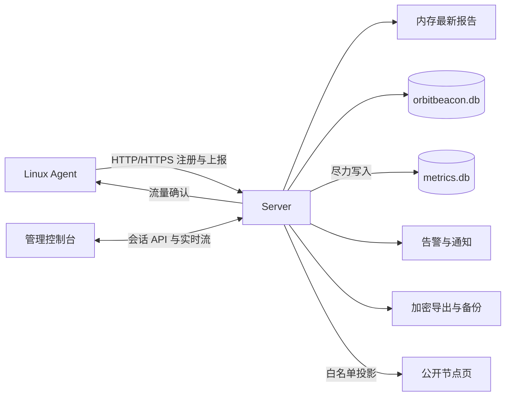

# 架构与数据边界

OrbitBeacon 由中心 Server、Linux 非 root Agent 和内嵌网页组成；不依赖外部数据库、消息队列或前端服务。操作步骤见[部署与备份](../deploy/README.md)、[Agent 接入](agent.md)，字段定义见 [OpenAPI](../api/openapi.yaml)。

## 组件与数据流

| 入口 | 职责 |
| --- | --- |
| `cmd/orbitbeacon-agent`、`internal/agent/` | 安装策略与身份校验、采集、探测、注册和上报 |
| `cmd/orbitbeacon-server`、`internal/server/` | 目录锁、恢复收敛、存储、HTTP、告警、通知、备份和保留清理 |
| `web/src/` | 公开页与管理控制台，构建后嵌入 Server；运行不需要 Node.js |

Server 主监听仅提供 HTTP；公网 HTTPS 与 HSTS 由外置代理提供。`public_url` 固定浏览器可信源，不从请求 Host 或转发头推断；HTTP 不加密密码、会话及 Agent 凭证。

## 采集与身份

Agent 使用一个采集循环和一个上报 worker，每次采集最多 3 秒。普通指标没有离线队列：请求或退避期间只保留最新采样，恢复后不补历史。流量另有内存累计，最多保留 24 个未结算小时桶，重启或超量可能丢失。

Agent 本地控制上报/采集周期、磁盘周期、网卡、路径和探测目标。SIGHUP 在采样边界应用完整有效配置，失败保留旧值；Server 只观察 runtime，不下发运行参数。账期与配额是独立的 Server 设置，不执行网络限速。

Server 从凭据映射节点，在读取正文前捕获 `credential_epoch`；撤销或替换凭据使旧准入和排队事务失效。`run_generation`、`session_id` 防止旧进程争抢，`seq` 防止重复或旧报告回滚状态。

遥测正文最多 64 KiB，须为单个 JSON 对象。未知字段被丢弃，不进入最新报告或公开投影；已知指标和来源仍校验，磁盘与网卡各最多 8 条。注册、恢复、管理写入和本地配置拒绝未知字段。

## 当前状态与历史

- 完整最新报告、接收时间和公开指标快照在内存中。`/api/v1/nodes/{id}/latest` 不是历史查询；Server 重启后资产与已落库 `last_seen` 保留，完整数字须等待新报告。
- 普通报告的 `last_seen` 默认约每 30 秒落库；新运行、会话、system 或 runtime 变化触发事务。读取时核对凭据、绑定 epoch、代次和会话，不展示旧身份报告。
- 在线窗口为 Server 最近接收报告后的 180 秒，不依赖 Agent 墙钟，也不代表业务健康。指标来源超过 `max(3 × source_interval, 45s)` 才标旧，等号仍新鲜。
- 当前报告中合法的 ok/stale 数字失联后保留，error/unsupported 或缺值显示不可用；不从更早报告拼补。uptime 固定为报告值。告警和历史不消费过期指标。
- 浏览器连接失败只标旧，不推断离线；心跳只校时，不刷新采样时间。浏览器使用 Server 时间与单调增量计算新鲜度，不递增数字。

### 流量与探测

流量按进程 epoch 和 UTC 小时累计，同一桶重复上报取最大值；Server 仅确认已持久化值或已超出 35 天窗口的废弃条目。API 合并小时桶与日汇总，按 `billing_day` 计算 UTC 月账期，字节用十进制字符串返回。

探测结果随报告持久化，按 `checked_at` 去重。当前目标未完成检查为 pending；移除目标同时清理旧结果与缓冲。失联保留最近目标，24 小时可用率按 UTC 小时桶统计。探测协议和网络权限见 [Agent 文档](agent.md#服务探测)。

撤销或真正替换节点凭据会清除 runtime、last_seen、system、运行身份与探测观察，保留资产和累计流量；同凭据幂等注册不清除。

## 浏览器实时传输

公开 `/api/public/v1/nodes`、`/stream`、`/ws` 共用匿名白名单；私有 `/api/v1/live`、`/stream`、`/ws` 共用管理会话。协议使用 `snapshot / heartbeat / close / error` frame，`server_time` 为消息时钟，`data.generated_at` 为投影生成时间。

首份立即返回，普通变化按 `web_update_interval_seconds` 合并（默认 10 秒，2–60 秒，重启生效）；静默每 10 秒心跳。公开页按周期缓存并合并同页查询，持续变化时可能返回 `503 snapshot_busy` 和 `Retry-After`，不发送已知过时快照。

撤回公开、禁用、撤销或替换活跃凭据会立即要求流重建，普通文字修改和新增按周期发布。安全检查不能召回已送达或离线保留的数据。

WS/SSE 共用每 IP 4 条、全局 200 条、最长 15 分钟限制；私有流还受会话到期约束，并在每份快照/心跳前复核会话。WS 要求 Origin 精确匹配 `public_url`，禁用压缩，不接受应用写消息。

浏览器自动按 WS → SSE → HTTP 回退；隐藏时停止，恢复时重连。控制台恢复可见先校验 `/me`；已知会话到期即使断网也清空私有页面，远端未知撤销须等下次通信。实时补丁不覆盖草稿、筛选和勾选。客户端接口与更新约束见 [Web 开发文档](../web/README.md#实时更新与会话)。

## SQLite 与保留

主库 `orbitbeacon.db` 保存账户、资产、身份、配置、审计、流量、探测、告警、通知和备份任务。使用纯 Go SQLite、WAL、外键、5 秒 busy timeout、`synchronous=FULL` 和 immediate 写事务；公开查询使用独立只读连接池。

**主库 schema 20**：空库单事务直接建表并写入一条当前版本记录，不执行历史迁移。旧库（含 schema 19）、缺失/空/混合版本记录和更高版本库均拒绝，不改写业务数据或删除文件。

`metrics.db` 独立使用 **schema 1**，只存成功且新鲜的标量聚合，不存原始报告。非阻塞有界缓冲约每分钟写入分钟聚合与 rollup，无数据不补零，缓冲满时丢弃。该库打开失败时主服务继续，历史接口可返回空点集。

| 数据 | 保留规则 |
| --- | --- |
| 指标历史 | 1 分钟粒度 48 小时；5 分钟粒度 14 天；1 小时粒度 90 天 |
| 流量 | 小时桶 35 天，完整过期日转为日汇总；日汇总 400 天 |
| 服务探测 | 最新结果及小时统计；小时统计 7 天 |
| 审计 / 已恢复告警 | 90 天；告警从恢复时间计算 |
| 通知投递 | 已发送或失败记录 30 天；不按此规则删除 pending |
| 站内通知 / 任务 / 归档密码 | 通知创建后 90 天；终态任务和密码完成后 90 天 |
| 手动导出文件 | 完成后 24 小时；计划包按本地份数或云端生命周期保留 |
| 接入票据 | 过期后额外保留 24 小时 |

保留清理每小时分批执行，同时处理过期会话。已删除节点的历史可能滞留至清理，但历史 API 先校验节点存在。已读记录按账户隔离，通过通知外键级联清理。

## 备份一致性与恢复

操作、归档范围、存储配置和恢复命令集中在[部署文档](../deploy/README.md#导出与备份计划)。关键边界：

- 仅备份已落库数据，不暂停采集或冲刷内存；主库与指标库分别取一致快照，不保证跨库同一时刻。选择 Monitoring 而历史库不可读时任务失败。
- 按固定表/列白名单生成传输库，避免未选数据残留。流式压缩加密，不落盘明文归档；恢复验证认证、清单、哈希、精确 DDL 与行值。
- 格式 v1、主库 schema20、指标库 schema1 必须精确匹配，不跨 schema 转换或接收 schema19 归档。类别整体替换，稳定 ID 依赖不满足则整次拒绝。配置包含用户 `must_change_password` 整数标志（仅 0/1），还原保留正常/待改密状态。
- 导出持久排队，全局最多 32 个非终态任务、一个 worker。阶段为 snapshot、packaging、storing；重启保留 queued，running 转为 failed，错误码为 interrupted，存储中断可能结果未知。发布后只重试终态及站内通知事务，不重复上传。
- 恢复在相同目录锁下用 prepared/committed journal 安装文件组：prepared 回滚完整旧组，committed 仅清理 journal。配置恢复停用计划，不导入会话或接入票据；事件恢复不重放任务或外发投递。

## 告警与通知可靠性

启动时评估一次，此后每 30 秒评估已注册、启用的节点。指标须匹配当前身份且新鲜；缺失/过期重置等待计时，但不证明恢复。磁盘取有效磁盘的最大使用率，`probes_down` 无结果时为零。离线规则按最近接收时间、无上报时按注册时间，最短阈值 180 秒。

恢复有滞回；等待计时在内存，重启重置。已触发事件持久化，同规则/节点最多一个未恢复事件；删除规则或作用域保留历史，未恢复事件在后续评估结束。

站内通知与告警状态变化或备份终态同事务提交，不依赖外发成功；安全详情快照在来源过期后仍可读。所有管理员可见，已读状态独立，未读数不等于 firing 数。

外发支持 Webhook、Telegram、邮件。事件提交后先经有界内存队列，再创建持久 pending 投递；临时失败最多尝试 5 次，退避 1、5、15、60 分钟，每通道 20 次/分钟，积压 100 条时合并后续通知。

**外发不是恰好一次投递**：远端接收后、状态落库前崩溃可能重复；事件提交后、投递入库前崩溃或内存队列满可能丢失。备份结果仅站内通知，不外发。

## 安全与关闭

- Agent 安装策略固定信任根、地址、状态目录和非 root 运行身份；主机失陷后凭据及采集结果不再可信。探测配置等同授权 Agent 访问目标网络。
- 浏览器使用 host-only、HttpOnly、SameSite=Lax 会话 Cookie；仅 HTTPS `public_url` 启用 Secure。管理写入校验 Origin 和 CSRF。账户均为等权管理员；更名保留会话，删除撤销目标会话，至少保留一名管理员。初始化账户始终要求首次登录改密，新建账户可选（默认否）。待改密会话仅允许 `GET /api/v1/me`、`PATCH /api/v1/me/password`、`DELETE /api/v1/session`，其他已识别管理路由返回 403 `password_change_required`，不影响匿名公开与 Agent API。改密验证旧密码后拒绝相同新密码（400 `password_unchanged`）；同事务更新哈希、清除标志并撤销本人全部会话。成功仅返回 204，不发送 `Set-Cookie`，必须重新登录，迟到响应不会清除新会话 Cookie。
- 公开信息独立配置，不从内部元数据回填；仅投影公开字段、状态和 CPU/内存/负载/uptime，不返回完整报告。
- 数据目录、数据库、sidecar 和 `secrets.key` 是本地信任根，严格检查所有权、权限和无符号链接。`server.lock` 不删除；禁止多个 Server 共用目录。
- 通知凭据和完整 Webhook URL 使用 `secrets.key` 派生的 AES-256-GCM 密钥加密。默认拒绝私网、回环及元数据目标；拨号校验最终 IP，HTTP 不使用代理或重定向，SMTP 要求 TLS。放宽选项见部署文档。

SIGINT/SIGTERM 或 HTTP 服务退出后，Server 先标记不就绪、停止实时流，在共享 10 秒期限内关闭 HTTP；ingest、通知停止和历史刷新另有超时，退出后台任务后关闭数据库并释放锁。强制终止可能丢失内存中的合并状态或历史。
