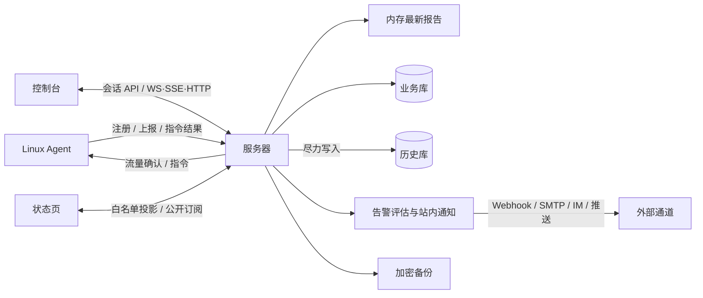
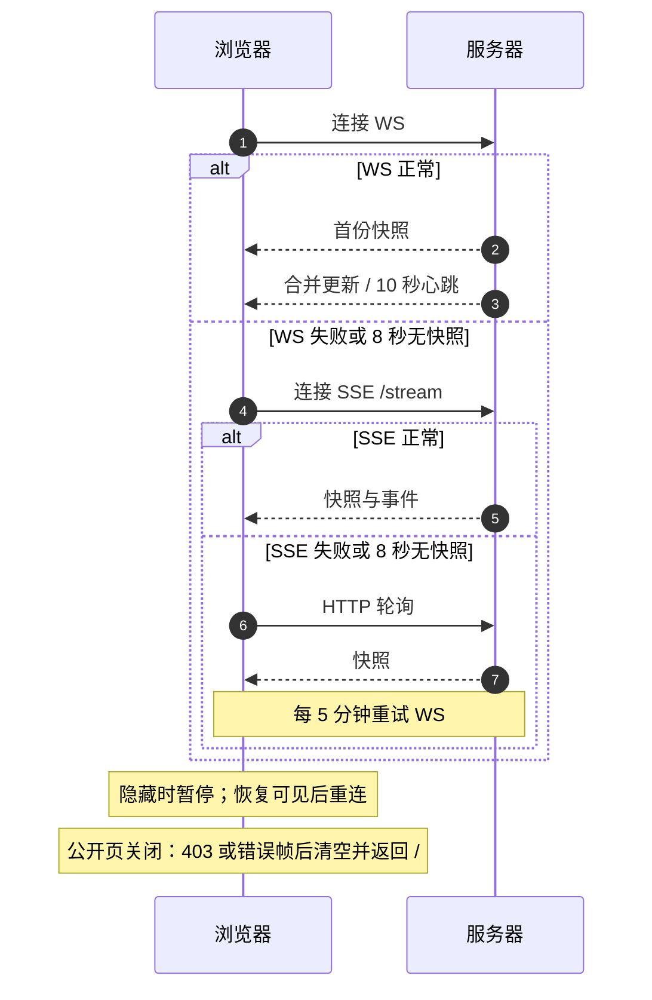
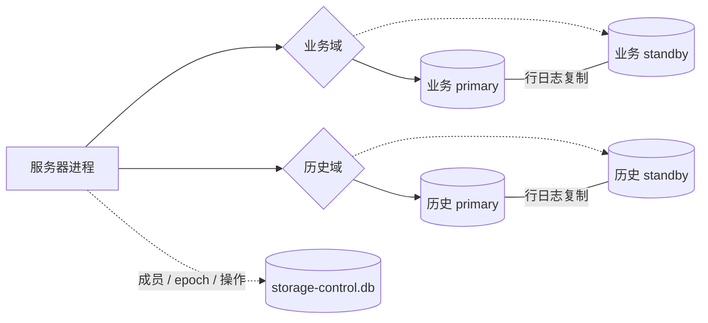

# 架构与数据边界

操作步骤见[部署指南](../deploy/README.md)与 [Agent 指南](agent.md)，术语见[约定](conventions.md)。

## 数据流



- Agent 本地决定采集和探测参数；配置仅保存在 Agent 本地，服务器按节点凭据识别节点，用凭据代次、运行代次、会话和序号隔离旧进程和旧报告。
- 上报只保留最新普通样本，断网后不补历史；流量累计规则见 [Agent 指南](agent.md#流量累计)。
- 业务库保存账户、资产、设置、流量、探测、审计、告警、通知和备份任务；历史库保存指标聚合。两库一致性与主备切换见[存储与保留](#存储与保留)。
- 遥测忽略未知字段；已知字段仍校验，注册、恢复和管理写入拒绝未知字段。请求限制见[接口契约（OpenAPI）](../api/openapi.yaml)。

内部包依赖由 `internal/architecture/architecture_test.go` 逐包约束，新增依赖须同步审查和声明。历史清理复用 `timekey` 的固定精度时间键；存储故障通知通过 `notify → inbox` 写入站内通知。

## 状态与历史

- **在线 / 离线**：服务器收到上报后 180 秒内算在线，超过才算离线。只看服务器时间，不代表业务健康。状态页缺少有效运行身份、接收时间或时间异常时显示未知；控制台另外区分待注册、未上报和禁用。
- **已过期**：指标年龄超过 `max(3 × source_interval, 45s)`，或来源已标为 `stale`，就算过期。浏览器断网只会把数据标记为过期，不会自行判定节点离线。
- **指令**：封闭指令队列在上报身份检查通过后，于同一事务处理并审计，不进入备份。最新的 stop 成功，且下发时的 `run_generation` 仍是节点当前值时，派生 `stopped`，抑制 offline 告警并触发恢复；任何新进程都会清除这个状态。
- **最新报告**：完整报告只存在内存。重启后资产和已落库的 `last_seen` 还在，但指标要等新上报。普通 `last_seen` 每 30 秒加一个按节点 ID 计算的偏移（不足 30 秒）落库一次，到期后的下一次上报写入；首次上报、运行身份、system 变化立即落库。
- **指标可用性**：当前报告里有效 `ok` / `stale` 的数字，失联后保留；缺失、`error` 或 `unsupported` 显示不可用，不从旧报告拼补。数字和 uptime 不会自己增长，心跳也不刷新采样时间。
- **历史与告警**：只消费成功且新鲜的指标。历史缓冲有界且非阻塞，满了就丢；历史库打不开不影响主服务，但查询可能为空。
- **流量**：按进程 epoch 和 UTC 小时累计，同一桶的重复值取最大值；服务器只确认已持久化或超过接收窗口的条目。账期按 UTC 月和 `billing_day` 计算，字节用十进制字符串返回。`billing_mode` 支持收发合计、较大值、仅接收、仅发送；`used_bytes` 是账期计费用量，各计数封顶 int64。配额只告警，不限速。
- **配额告警**：`traffic_quota_percent` 每个 tick 用一个读取快照批量合并日/小时计数，按节点计费日计算，阈值范围 (0,1000]，支持比较符和持续时间。离线不影响评估；读取失败不会触发或恢复，配额清零或账期回落可以恢复。本地关闭 traffic/network 会阻止新告警，恢复需要新鲜报告。
- **探测**：按 `checked_at` 去重。当前目标还没有结果时是 pending；移除目标仅从最新报告中消失，历史按 7 天保留策略清理；失联则保留最近观测。24 小时可用率按 UTC 小时统计。
- **可用率**：`availability` 后台任务每 60 秒在同一写事务中读取当前身份并累计到业务库 `node_availability_daily`（UTC 日），每批最多 500 个节点，增量最多 90 秒。在线判断合并已落库 `last_seen` 与同凭据、凭据代次、运行代次、会话和存储世代的最新内存接收时间，不增加上报落库频率。首次 tick 和时钟回拨只重设内存基线；启动后 180 秒内只记录在线。停机和未观测时长算未知，不进入百分比分母。保留任务分批保留最近 90 个 UTC 日。匿名页缓存未命中时批量查询最近 30 天，公开流复用同一页；控制台通过管理员路由读取 30 或 90 天。
- **服务监控**：`services` 由服务器执行，与 Agent 探测独立，最多 100 项。一个调度 goroutine 管理 next-run 与 reload，8 个 worker；启动时错峰，间隔有 ±10% 抖动。同一服务不重叠执行；两次失败判 down，一次成功恢复，高延迟需连续三次，恢复一次即可。HTTP 记录响应头延迟，TCP 记录连接延迟，Linux ICMP 使用无特权 datagram ping socket（IPv4/IPv6），三包平均成功 RTT / 丢包率。所有解析与拨号经过允许私网的 `egress.Dialer`，元数据端点仍拒绝。非 Linux 为 unsupported；只有 Linux socket 的 EACCES/EPERM 提示 `net.ipv4.ping_group_range`。
- **服务存储与通知**：配置在业务库 `services`（注册 ID 33），最新结果及持久化状态机在 `service_checks_latest`（34）；历史库 `service_check_buckets`（35）保存 5 分钟检查数、成功数、成功延迟 sum/min/max，分批保留 30 天。每 10 秒批量提交，最新状态、站内通知和共享 notification outbox 同事务；故障/恢复、高延迟/恢复、14 天内证书到期（每天最多一次）在 notify 开启时向所有启用通道投递，重试、限流和合并复用告警路径。业务库写失败暂停新检查并重试；历史库故障只丢当前历史批次并记录日志，不停止检查或公开状态，显式历史查询仍返回错误。
- **服务投影与备份**：可用率按成功样本/检查样本计算，不是在线时长；缺样本为 null，延迟仅统计成功检查。公开页仅输出 enabled+public 的名称、类型、状态、延迟和最近 30 个 UTC 日百分比，不含目标或错误；结果超过两个间隔加超时变 unknown。配置归 Configuration，最新结果与桶归 Monitoring，通知及审计仍归 Events，与节点备份分类一致；历史孤儿不导出，恢复检查 service_id 依赖。目标、类型、启用或延迟阈值变化重置状态，但保留同一服务 ID 的历史。
- **凭据**：吊销或替换节点凭据会清除运行身份、system、`last_seen` 和探测观察，保留资产及累计流量；用新密钥绑定相同凭据不清除这些状态。密钥只授权一次激活，之后的恢复使用独立节点凭据，不消费密钥，也不刷新在线状态、代次或会话。禁用节点保留凭据。
- **额外指标**：Linux Agent 还采集物理整盘 IO 速率和最高忙碌率、PSI some avg60（CPU/内存/IO）以及最热有效传感器温度。这些值以可空字段和七条标量历史序列保存，不增加来源元数据；不支持或采集失败时省略，本地关闭时通过 `metric_status` 的对应 `disabled` 键标识。温度最多一个后台任务，每分钟刷新，缓存超过三分钟丢弃。匿名状态页仍只暴露原有字段。

## 实时传输

状态页与控制台自动按 **WebSocket → SSE → HTTP** 回退；隐藏页面暂停，恢复可见后重连。控制台在恢复时先复核会话。



- 实时更新只改只读数据，保留草稿、筛选和勾选。降级后每 5 分钟尝试恢复 WebSocket。
- 控制台节点列表在在线状态后显示 CPU、内存两列，随舰队帧原位更新，不重载列表，也不改变筛选、排序和勾选。首屏和服务器重启后，在新上报到达前显示占位符。`cpu_percent`、`memory_used_percent` 只在当前身份匹配、`presence=online` 且对应 `metric_status=ok` 时是数字；内存按 `100 * (total - available) / total` 计算，总量为零或缺失时为 null。摘要随原文一起发布，投影不解码报告；令牌视图和匿名状态页的字段不变。
- 首份快照立即返回，普通变化按[网页更新配置](../deploy/README.md#配置参考)合并；没有变化时每 10 秒发一次心跳。`429` / `503` 的 `Retry-After` 会延后重试；持续变化可能返回 `503 snapshot_busy`。
- WS/SSE 共用限制：每 IP 4 条、全局 200 条、最长 15 分钟；私有流还受会话有效期约束。WS 要求可信 Origin，不接受应用写消息。
- 撤回公开、禁用节点，或吊销/替换活跃凭据，都会要求流重建；已经发出或离线保留的数据无法召回。

全站开关在“设置 → 状态页 / Settings → Status page”，默认开启。`/` 和 `/public.html` 的 GET/HEAD 在 ETag 处理前按下表分流，响应不缓存：

| 开关 | 匿名或无效会话 | 正常管理员会话 | 待改密会话 |
| --- | --- | --- | --- |
| 开启 | 状态页 | 状态页 | 状态页 |
| 关闭 | 302 `/login` | 302 `/overview` | 302 `/change-password` |

- 关闭后，`/api/public/v1/nodes`、`/api/public/v1/stream`、`/api/public/v1/ws` 返回 `403 public_page_disabled`；已有流会先发一帧不含节点数据的同码错误帧，再关闭。页面只有收到明确的禁用信号才清空数据并返回 `/`；普通网络或服务错误只重试。
- 静态资源、Agent API、管理权限和节点公开白名单不受开关影响；重新开启也不会发布私有节点。会话存储故障返回错误，不当作匿名访问。
- `GET/PATCH /api/v1/settings/public-page` 同时提供 `enabled` 与 `show_groups`（默认 false）；PATCH 可只改其中一项，变化字段与一条审计同事务提交，无变化不写入。开启分组后，匿名快照的 `node_groups` / `service_groups` 是含公开成员的组名数组，保持控制台顺序；节点组列表覆盖所有分页。每个成员的 `group` 是数组索引，未分组为 null；关闭时这些键全部省略。组 ID、私有组及成员总数不公开。
- 节点组编辑在提交后递增公开可见性版本；节点移动沿用元数据失效。监控组编辑和移动沿用监控变更通知。缓存按显示开关分键，并检查可见性版本与数据库世代；HTTP/SSE/WS 的最终出口仍检查版本。实时差异比较包含组名与索引，关闭分组立即要求已有流重建，避免继续发送旧分组。
- 开关的持久化值损坏会拒绝启动；备份与恢复见[归档范围](../deploy/README.md#归档范围)。`/status` 不提供页面。

## 存储与保留

### 数据库

- 默认 SQLite：`orbitbeacon.db` 保存账户、资产、身份、设置、流量、探测、审计、告警、通知和备份任务；`metrics.db` 保存指标历史。使用 WAL、外键、`synchronous=FULL` 和 immediate 写事务。配置 MySQL primary 后，业务和历史两个逻辑域分别使用该端点的 database，不再创建本地替代库。
- 业务库和历史库各自持有稳定句柄。请求从认证到响应固定同一世代，写 gate 串行化写事务，租约覆盖提交后的内存发布。后台通知和备份固定认领、网络操作和结果保存的世代，但不边等网络边占 SQL 事务。长连接只在认证、读取和发送时持租约，等待更新时释放。
- 取消租约会传到实际 SQL；排空要等查询结果、语句、事务和驱动回滚真正结束，不能只看 Go 调用返回。请求取消或超时不标记数据库故障。readiness 通过 guard 写探针确认主库可提交后才恢复；liveness 不依赖数据库。
- `metrics.db` 保存标量、分盘使用率（字节和 inode）的分钟聚合及 rollup，不保存原始报告，没数据也不补零。每节点最多 16 个不同分盘路径，同一路径的两个序列共享名额；新路径超额时丢弃并计入 `orbitbeacon_history_series_rejected_total`，已知路径和聚合继续写入。
- 路径集合和写入由一个 goroutine 管理。历史序列上限为 200 节点 × (17 个标量 + 16 路径 × 2) × 3 档精度 = 29,400，每条序列的桶数另受保留期限制。`buckets.metric` 是普通文本，备份注册表按列原样备份和恢复，含 `:` 的分盘指标不需要新表或改注册表。格式兼容性见[升级](../deploy/README.md#升级)。
- MySQL 使用事务型 InnoDB。TCP 省略 `tls` 就是明文，只适合受控网络；凭据和数据都没有传输加密。显式 `tls: {}` 启用 TLS 1.2+，默认校验系统根和 address 主机名；指定 CA 或 `server_name` 时按配置验证，失败不回退明文。本机 Unix socket 不接受 TLS。
- 写事务先取得域内写 gate 和数据库 guard；COMMIT 结果未知时先冻结并核对事务 UUID，不能直接重做业务。单库模式不生成复制行日志。池指标读取当前域；MySQL 不报告遗留的本地 SQLite WAL。
- MySQL 启动时检查可写、事务型 InnoDB 和持久提交；启用 binlog 还要求同步刷盘和触发器部署条件，详见[数据库部署](../deploy/README.md#数据库)。开发地址和库名见[远程开发环境](../temp/README.md)。

### 主备与切换

仅配置 MySQL primary 与 standby 时存在下图；省略 standby 时只有一个数据库端点，不创建复制 worker 或控制库。图示为初始角色，active 可由任一端点承担。



- 配置 `database.standby` 后才会建立成员身份、事务行日志和两个独立复制 worker；默认单库不启动这些后台任务，控制文件只在 HA 初始化时创建，清退后仍要保留。源事务按固定表/类型清单捕获完整行镜像（after image），目标按原事务和序号应用；副本不承担普通查询。
- HA 控制文件保存本地权威、成员、人工操作、故障通知 outbox 和用途隔离的加密频道快照，不是第三份业务副本。初始同步固定源一致快照和后续日志，管理员初始化完成后才启动；半复制目标不能 ready。整库恢复会建立新 epoch，旧副本要重新同步。
- 业务和历史各自排空：历史按分钟/节点分批写入，三档聚合同事务；HA 行日志单事务最多 64 MiB，每域保留 24 小时、256 MiB。区间被淘汰前先撤销落后副本资格；目标遇到确定性约束冲突会回滚并停止复制，不保留错误的完整副本资格。
- 主备按域独立选择权威。首次 suspect 冻结准入、取消旧世代，排空后才验证候选、持久切换意图、新 epoch 和 active 指针。公开设置要能从候选租约读到；未知设置返回 `503`。默认 30 秒失效、10 秒可证明丢失窗口、60 秒连续稳定回切、24 小时人工锁；详细操作见[自动故障切换](../deploy/README.md#自动故障切换)。
- 人工操作要预览，绑定用户/方向/实例/epoch/修订，5 分钟内确认后排队；协调器异步执行。活动成员禁止重建，人工提升必须显式接受丢失。Web 认证不可用时用停服 CLI，见[人工恢复](../deploy/README.md#人工恢复)。
- 正常切库不重建 ingest/history 服务：同身份私有 pending 保留，未知提交先解析；公开投影和旧准入不跨世代。告警会重置未完成的持续计时，可用率重设时基，不补计另一条时间线。
- 节点删除和 `node_deletions` 墓碑同事务提交；历史只清理有效墓碑且业务域已无节点的记录。墓碑保留到删除小时加 90 天再加 1 小时，已清理数据不会因节点复活自动补造。

### 保留

| 数据 | 保留规则 |
| --- | --- |
| 指标历史 | 1 分钟粒度 48 小时；5 分钟粒度 14 天；1 小时粒度 90 天 |
| 流量 | 小时桶 35 天，完整过期日转日汇总；日汇总 400 天 |
| 探测结果与小时统计 | 7 天 |
| 审计 / 已恢复告警 | 90 天；告警从恢复时间计算 |
| 通知投递 | 已发送或失败记录 30 天；pending 不按此规则删除 |
| 站内通知 | 创建后 90 天 |
| 终态任务 / 归档密码 | 完成后 90 天 |
| 手动导出文件 | 完成后 24 小时 |
| 密钥 | 过期后额外保留 24 小时 |

服务器每小时分批清理并处理过期会话；登录时也会清理部分过期会话。已删除节点的历史可能留到清理时才消失，查询会先校验节点存在。计划包的保留由[备份目标](../deploy/README.md#备份目标)决定。

管理员可在“设置 → 数据 → 存储与清理”（`/settings#data-storage`，旧 `/data` 链接自动跳转）查看当前活动域统计，并按类别手动清理，步骤见[数据清理](../deploy/README.md#查看与清理数据)。客户端提交固定时间边界，服务端验证保留天数和类别白名单；每类最多 5000 行，逐个小事务提交并保留审计，不承诺跨批次或跨域原子性。删除沿稳定租约和写 gate 进入普通事务，因此参与 HA 捕获；手动清理接口本身不执行空间整理。

SQLite 和 MySQL 的空间整理能力均为可用；仍通过独立的 `/api/v1/data-management/compact` 接口，以精确的 `COMPACT` 确认并校验管理员会话、Origin 和 CSRF。整理沿稳定租约和写 gate 在事务外执行，只作用于所选当前活动逻辑域，应用不直接操作备库，不删除业务行：SQLite 执行 `VACUUM` 与 WAL checkpoint，MySQL 对所选当前活动逻辑域的 InnoDB 实体表逐表执行 `OPTIMIZE TABLE`，包含该域内部元数据，不遍历其他 schema，不操作视图或非 InnoDB 表。物理维护不通过应用行复制同步备库；若配置 MySQL 原生 binlog 复制，语句按既有原生复制规则传播。逐表完成不可整体回滚，失败或取消不能撤销已完成的表整理，失败或响应中断后先刷新核实，禁止自动重试。

整理会阻塞应用写入，MySQL 还可能等待或持有元数据锁，并需要额外磁盘空间，应在低峰且空间充足时执行。分配空间不等于操作系统已经回收，整理也不保证归还磁盘；MySQL 独立 `.ibd` 表空间可能释放文件空间，共享表空间通常只供内部复用，不承诺缩小系统表空间 `ibdata1`。MySQL 整理需具备所整理表的 `SELECT`、`INSERT` 权限。

## 备份

- 只备份已落库数据，不暂停采集，也不强制冲刷内存。两库各自一致，不保证同一时刻；选了监控数据但历史库不可读时，任务失败。
- 恢复非监控归档时，缺失的本地历史只在私有恢复目录里按空库准备；已存在但损坏的文件或孤立 sidecar 仍拒绝，不覆盖原数据。MySQL 先保存完整的 old/new 私有镜像和 key，再持久化 prepared 决定，逐域替换；committed 前中断会恢复全部旧状态，之后只完成新状态。数据库不可达时保留待决操作并拒绝服务，不打开半恢复系统。
- 按表/列白名单生成传输库，流式压缩加密，不落盘明文归档；恢复时校验认证、清单、哈希、DDL 和行值。
- 全局最多 32 个非终态任务，单 worker 执行。认领 queued 任务时若提交结果未知，保留原事务收据并等待解析，确认提交后才执行一次；确认回滚后允许重新认领。重启或业务世代变化时保留 queued；当前库遗留的 running 标为 `failed` / `interrupted`，storing 另标 `storage_outcome_unknown`，不重复上传。worker 空闲不持租约，靠旧世代取消信号唤醒恢复；结果未知按[计划排障步骤](../deploy/README.md#计划)检查。
- 恢复由同一目录锁保护；prepared journal 回滚旧文件组，committed journal 不重放逻辑数据：SQLite 清理文件，MySQL/HA 还要校验目标并完成控制状态收尾。操作和故障处理见[恢复](../deploy/README.md#恢复)。

## 告警与通知

- 启动时及每 30 秒评估已注册、启用节点。缺失或过期指标会重置等待计时，但不代表恢复；离线规则在没有上报时从注册时间算，最短阈值 180 秒。
- 磁盘取有效磁盘的最大使用率；`probes_down` 没有结果时视为关闭，任一结果为 `pending` 时无数值。`probe_failed`、`probe_latency_ms`、`probe_tls_expiry_days` 只看规则指定目标；首次检查完成前显式上报 `pending`，不触发或恢复事件；新鲜报告缺少规则目标时视为移除并恢复事件。主机指标以 `metric_status` 的 `disabled` 状态恢复事件，过期或缺失报告不能触发恢复。恢复有滞回，等待计时在内存中，重启会重置；已触发事件持久化，同一规则/节点最多一个未恢复事件。
- 删除规则或作用域会保留历史，未恢复事件在后续评估中结束。没有绑定通知通道，仍会生成告警事件和站内通知。
- 站内告警变化和备份终态随业务事务提交；存储故障转变随权威状态在控制事务提交，业务库恢复后按事件 UUID 幂等投影。所有管理员共享通知，已读状态各自独立；来源过期后仍能看到安全快照，未读数不等于当前触发数。备份结果只发站内通知。
- 外发支持 Webhook、Telegram、邮件、飞书、钉钉、企业微信、Bark、ntfy。pending 投递与告警事件、站内通知同事务提交，提交后唤醒 worker，并有持久化轮询兜底。临时失败最多试 5 次，退避 1、5、15、60 分钟；每个通道每分钟 20 次，积压到 100 条后合并后续通知。
- 外发可能延迟、重复或丢失：远端已接收但状态没落库，可能重复；重试耗尽、不可重试的响应或通道禁用会放弃；洪泛合并只保留数量和最新详情。它不能替代独立的高可靠告警系统。
- 存储故障通知使用独立的 control outbox 和固定 `StoragePayload`，不依赖故障业务库读取频道凭据。guard 内先持久暂停快照，再改业务 SQL；同世代重读后用 generation/cache_revision 双匹配发布，结果未知就保持暂停。
- 已验证快照可在双业务主备失联时继续外发，当前世代校准后再恢复暂停的发送；失效快照不回退到旧凭据。
- 两类外发共用四个发送槽和每频道持久限速。故障 outbox 每频道 pending 上限 100，保留当前人工处理事件，优先淘汰已结束故障的旧待发。事件和终态保留 30 天，终态最多 1000 条；逐次探测不会生成新通知。

## 前端边界

- `web/src/console/` 是管理端入口、路由、页面与组件；`web/src/public/` 保存匿名状态页的数据校验与生命周期。`web/themes/<name>/` 提供公开首页的 HTML、样式与展示组件，构建时只选择一个主题，不改变管理端。
- 两个入口复用 `web/src/shared/` 的实时传输、格式化、国际化、明暗模式与基础 token；自定义首页覆盖应留在主题目录，不能通过修改共享 token 影响控制台。
- esbuild 输出固定资源路径，内容版本写入查询参数与清单；Go embed 保持无 Node.js 的部署方式。HTML 不缓存，只有与内容匹配的版本 URL 才长期缓存。构建、主题接口和 CDN 配置见 [Web 开发](../web/README.md)。

## 安全

- 管理会话、密钥和节点凭据互不通用；匿名 API 只能读公开白名单。管理写入校验 Origin 和会话绑定 CSRF，登录也校验 Origin。Cookie 与代理配置见[配置参考](../deploy/README.md#配置参考)。
- 新签发密钥固定 30 分钟、仅一次成功激活；节点绑定、密钥消费、认领记录和成功审计同事务提交。过期、撤销、已使用或未知密钥统一返回 403；失效密钥在读取请求体前受有界 IP/global 预算保护，耗尽仍为 403 并带 `Retry-After`。认领记录仅用于留档，不再授权重放。
- 所有账户都是等权管理员，至少保留一名。更名保留会话，删除会撤销目标会话；新增管理员可要求首次改密，默认不勾选。会话有效期 12 小时。
- 待改密会话只能查看本人会话、改密或退出，不影响匿名页和 Agent API。改密要验证旧密码，拒绝相同的新密码，并原子撤销本人全部会话；必须重新登录。浏览器会清除私有页面并阻止旧响应回写。离线时无法提前知道远端已撤销。
- 没有密码找回或代改密。保留至少一个可用管理员；密码丢失时由另一管理员删除重建。初始化规则见[初始化凭据](../deploy/README.md#初始化凭据)。
- 两步验证可选。启用时生成 10 个一次性恢复码；登录在密码之后校验 TOTP 或恢复码，重新生成恢复码会让旧码全部失效。管理员可在“设置 → 管理员”重置他人的两步验证。本人丢失验证器和恢复码时，停服运行 `orbitbeacon-server reset-totp --config /etc/orbitbeacon/server.yaml --username <name>`；默认 SQLite 也可用 `--data-dir <dir>`。目录锁阻止并发修改，命令只访问业务域，撤销目标用户全部会话和 API 令牌，并记录系统审计。
- 节点默认不公开。只有已注册、启用、有有效节点凭据且显式公开的节点才进入状态页。节点名称和状态始终公开，其余内容由 fields 白名单逐项选择；默认字段为 CPU、内存、负载、uptime 和可用性。地区优先使用手动值，否则使用自动位置。不公开完整报告。公开节点字段都是匿名可见内容，不会自动脱敏；不要写入凭据、IP、主机名、域名或秘密。
- Agent 主机失陷后，凭据和采集结果都不可信；信任根和运行身份由[安装策略](agent.md#手动前台安装)固定。探测配置的网络授权边界见[服务探测](agent.md#服务探测)。
- HTML 使用 CSP，禁止嵌入框架；默认静态资源同源。配置静态 CDN 时，只给脚本、样式、图片和字体增加该 HTTPS 源，API、WS、SSE 和表单仍走网站源。只有公开静态资源提供无凭据 CORS，API 不开放 CORS。
- 资产变更和审计同事务提交；批量操作逐节点提交，分别返回结果。通知凭据和完整 Webhook URL 用 `secrets.key` 派生的密钥做 AES-256-GCM 加密，出站限制见[通知网络](../deploy/README.md#通知网络)。
- 正常关闭时先标记不就绪、停止实时流，再限时关闭 HTTP 和后台任务、释放目录锁；强制终止可能丢失内存中的合并状态或历史。

## 只读 API 令牌

控制台在“设置 → API 令牌”（`/settings#api-tokens`）管理令牌与全局限额；账户页签仅包含账户、密码和两步验证。

管理员用 Cookie 会话和当前密码创建 `obt_` 令牌。创建事务会重新验证发起会话和密码哈希；明文只在创建响应返回一次，数据库只存 SHA-256。令牌最多 20 个，过期项也占名额。密码变更、在线或离线两步验证重置、删除用户，都会在同一事务撤销该用户的全部令牌。

管理路由的 `Authorization` 以 `Bearer obt_` 开头时，独立按令牌认证并完全忽略 Cookie；其他 `Authorization`（如反向代理的 Basic）不影响 Cookie 会话。`tokenRoutes` 白名单只开放节点、样本、历史、可用率、流量、探测摘要、告警、分组及服务监控读取。节点专用处理函数显式构造字段，排除备注、系统信息、Agent 探测目标及错误；服务监控读取包含服务配置、目标和最近错误，适合受信任的管理集成。新增管理路由默认不开放；写操作、归档下载、审计和账户操作全部拒绝。要求改密的所有者不能用令牌。`last_used_at` 最多每 5 分钟尽力更新一次，不记审计。API 令牌不进入备份，任意恢复后旧令牌失效。

每个令牌默认每分钟 600 次，范围 1–100000。管理员可改全局值，也可给单个令牌设覆盖值；清空覆盖值后回到全局值。全局值无效时回退到 600。内存令牌桶容量等于限额，每秒补充限额的 1/60，重启后重置；改限额后按新速率结算，不补发差额；认证成功但被禁止的路由也计费。超限返回 429 `rate_limited`，`Retry-After` 是向上取整的等待秒数。全局限额随配置备份恢复；计数器 `orbitbeacon_api_token_rate_limited_total` 不带令牌标签。

### Agent IP 地理位置

服务器记录 Agent 客户端 IP，并遵循 `trusted_proxies` 配置。默认启用 `geoip_lookup: true`：未手动设置地区的节点会将公网 IP 发送给 **ipinfo.io** 查询国家和地区。成功或无效响应后缓存 24 小时；IP 变化后重新查询。设置 `geoip_lookup: false` 或 `ORBITBEACON_GEOIP_LOOKUP=false` 可关闭外部查询，IP 记录仍保留。可选 `geoip_token` / `ORBITBEACON_GEOIP_TOKEN` 或 `geoip_token_file` / `ORBITBEACON_GEOIP_TOKEN_FILE` 提供 token，两者不可同时配置；文件须为同用户所有的 `0600` 普通文件。

公开设置为 `{enabled, fields}`。已发布节点始终显示自身名称、状态和 `last_seen`，其余键仅在选中时出现；已选中但无数据的指标为 `null`。地区优先使用手动值，否则使用自动位置。公开流量目前仅提供 `quota_bytes`，避免匿名请求逐节点查询账期用量。排序为 `display_order DESC, name, id`，集合不变时偏移分页顺序稳定。

配置备份包含显示权重和套餐字段。IP 与地理位置随 `last_seen`、`system` 归入监控类别：它们是运行观测，不是管理员配置。仅恢复配置时保留目标节点已有的运行观测，不从配置备份恢复地址。

## 容量参考

以下为单机实测（2026-11，fsync p50 25ms 的慢盘，每节点 2 磁盘、2 网卡、3 探测，10 秒上报，5 分钟）：

| 节点 | 上报分布 | 成功率 | 备注 |
|---|---|---|---|
| 200 | 均匀 | 100% | p95 35ms |
| 400 | 均匀 | 99.17% | 拒绝全部在首个 10 秒，之后为零 |
| 200 | 同步 | 96.62% | 拒绝主要在首 20 秒 |

首次上报必走持久写，服务器重启后全部节点会形成一次波峰，返回 `503 report_busy` 的 Agent 按 `Retry-After` 重试。这不是性能承诺，结果取决于磁盘。

## 开发压测

先在测试服务器为每个模拟节点分别签发一个分组部署密钥（新密钥 30 分钟有效、仅一次成功激活），逐行存入仓库外的文件。工具按顺序一节点一个密钥；不同密钥数不足时在发送请求前拒绝，遇到 403、409 或网络错误即停止并报告已注册数量，不更换密钥。工具会真实创建节点并保留在服务器，不进入发布产物。

```sh
go run ./cmd/orbitbeacon-load -url http://127.0.0.1:8080 -tickets-file /path/to/tickets -nodes 200 -interval 10s -duration 5m -jitter 4900ms -disks 2 -networks 2 -probes 3
```

`-jitter` 决定节点的同步程度：接近间隔一半时近似均匀分布，较小时模拟同时上报。配置 `metrics_listen` 后，可从 `/metrics` 读取连接池、写队列、flush 和 WAL 指标。

同一独立监听的 `GET /metrics/nodes` 导出节点 gauge，支持 HEAD，无认证；主监听不提供该路径。每次抓取用两条批量 SELECT 读取节点身份和资产标签，不读备注；只有在在线且凭据、凭据代次、运行代次、会话都通过同一身份检查时才导出内存样本。离线、待注册、禁用节点只保留 info、up=0 和可用的 `last_seen`；重启后没有内存样本也不补数字。

每个节点最多 3 条基础序列、9 条基础标量序列、7 条额外指标序列（磁盘 IO 3、PSI 3、温度 1），每个磁盘 4 条、每个网卡 2 条。磁盘 inode 的 `orbitbeacon_node_disk_inodes_total{node_id,path}` 和 `orbitbeacon_node_disk_inodes_used{node_id,path}` 在数据为 null 时省略。协议分别限制最多 8 个磁盘和 8 个网卡，因此单次抓取每节点最多 67 条，节点数受 `max_nodes` 限制。标签变化会产生新时间序列，Prometheus 基数还受保留期内资产、路径和网卡名变化影响。
