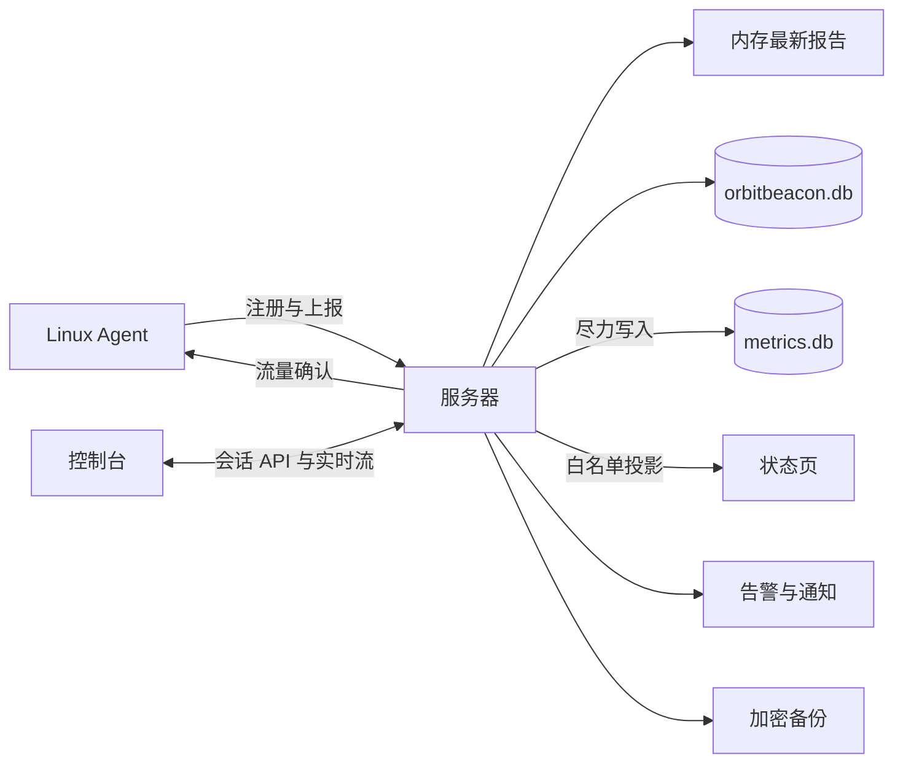

# 架构与数据边界

操作步骤见[部署指南](../deploy/README.md)与 [Agent 指南](agent.md)，术语见[约定](conventions.md)。

## 数据流

- Agent 本地决定采集与探测参数；服务器只观察运行参数，不下发配置。
- 服务器按节点凭据识别节点，并用凭据代次、运行代次、会话和序号隔离旧进程及旧报告。
- 上报只保留最新普通样本，断网后不补历史；流量累计规则见 [Agent 指南](agent.md#流量累计)。
- 遥测忽略未知字段；已知字段仍校验，注册、恢复和管理写入拒绝未知字段。请求限制见[接口契约（OpenAPI）](../api/openapi.yaml)。

## 状态与历史

- **在线 / 离线**：服务器最近接收上报后 180 秒内为在线，超过才离线；依据服务器时间，不代表业务健康。状态页缺少有效运行身份、接收时间或时间异常时为未知；控制台另区分待注册、未上报及禁用状态。
- **已过期**：指标来源年龄超过 `max(3 × source_interval, 45s)`，或来源已标为 `stale`。浏览器断网只标记数据已过期，不自行判定节点离线。
- 完整最新报告只在内存中；重启后保留资产与已落库的 `last_seen`，数字须等待新报告。普通 `last_seen` 约每 30 秒落库，运行身份、system 或 runtime 变化会提前持久化。
- 当前报告的有效 `ok` / `stale` 数字失联后保留；缺失、`error` 或 `unsupported` 显示不可用，不从旧报告拼补。数字及 uptime 不自行增长，心跳不刷新采样时间。
- 历史与告警只消费成功且新鲜的指标。历史缓冲有界、非阻塞，满时丢弃；历史库打开失败不阻止主服务，查询可能为空。
- 流量按进程 epoch 与 UTC 小时累计，同桶重复值取最大值；服务器确认已持久化或超过接收窗口的条目。账期按 UTC 月及 `billing_day` 计算，字节以十进制字符串返回；配额不执行限速，也不等同于云厂商账单。
- 探测按 `checked_at` 去重；当前目标尚无结果为 pending，移除目标清理旧观察，失联保留最近目标。24 小时可用率按 UTC 小时统计。
- 吊销或替换节点凭据清除运行身份、runtime、system、`last_seen` 和探测观察，保留资产及累计流量；同凭据幂等注册不清除。禁用节点保留凭据。

## 实时传输

- 状态页与控制台自动按 **WebSocket → SSE → HTTP** 回退。隐藏页面暂停，恢复可见后重连；控制台先复核会话。实时更新只修改只读数据，保留草稿、筛选和勾选。
- 首份快照立即返回，普通变化按[网页更新配置](../deploy/README.md#配置参考)合并；静默时每 10 秒心跳。`429` / `503` 的 `Retry-After` 会延后重试；持续变化可能返回 `503 snapshot_busy`。
- WS/SSE 共用每 IP 4 条、全局 200 条与最长 15 分钟限制；私有流还受会话有效期约束。WS 要求可信 Origin，不接受应用写消息。
- 撤回公开、禁用或吊销/替换活跃凭据会要求流重建；已发送或离线保留的数据无法召回。

全站开关位于“设置 → 状态页 / Settings → Status page”，默认开启。`/` 与 `/public.html` 的 GET/HEAD 在 ETag 处理前执行下表规则，响应不缓存：

| 开关 | 匿名或无效会话 | 正常管理员会话 | 待改密会话 |
| --- | --- | --- | --- |
| 开启 | 状态页 | 状态页 | 状态页 |
| 关闭 | 302 `/login` | 302 `/overview` | 302 `/change-password` |

- 关闭后，`/api/public/v1/nodes`、`/api/public/v1/stream`、`/api/public/v1/ws` 返回 `403 public_page_disabled`；已有流尝试发送不含节点数据的同码错误帧后关闭。页面收到明确禁用信号才清空数据并返回 `/`；普通网络或服务错误只重试。
- 静态资源、Agent API、管理权限及节点公开白名单不受开关影响；重新开启不会发布私有节点。会话存储故障返回错误，不当作匿名访问。
- 开关持久化值损坏会拒绝启动；备份与恢复处理见[归档范围](../deploy/README.md#归档范围)。`/status` 不提供页面。

## 存储与保留

- `orbitbeacon.db` 保存账户、资产、身份、设置、流量、探测、审计、告警、通知和备份任务；使用 WAL、外键、`synchronous=FULL` 与 immediate 写事务。
- `metrics.db` 保存标量分钟聚合及 rollup，不保存原始报告，无数据不补零。格式兼容性见[升级](../deploy/README.md#升级)。

| 数据 | 保留规则 |
| --- | --- |
| 指标历史 | 1 分钟粒度 48 小时；5 分钟粒度 14 天；1 小时粒度 90 天 |
| 流量 | 小时桶 35 天，完整过期日转日汇总；日汇总 400 天 |
| 探测小时统计 | 7 天 |
| 审计 / 已恢复告警 | 90 天；告警从恢复时间计算 |
| 通知投递 | 已发送或失败记录 30 天；pending 不按此规则删除 |
| 站内通知 | 创建后 90 天 |
| 终态任务 / 归档密码 | 完成后 90 天 |
| 手动导出文件 | 完成后 24 小时 |
| 注册票据 | 过期后额外保留 24 小时 |

服务器每小时分批清理，并处理过期会话；登录也会清理部分过期会话。已删除节点的历史可滞留至清理，查询先校验节点存在。计划包的保留由[备份目标](../deploy/README.md#备份目标)决定。

## 备份

- 仅备份已落库数据，不暂停采集或强制冲刷内存；两库分别一致，不保证跨库同一时刻。选择监控数据而历史库不可读时，任务失败。
- 按表/列白名单生成传输库，流式压缩加密，不落盘明文归档；恢复校验认证、清单、哈希、DDL 与行值。
- 全局最多 32 个非终态任务，单个 worker 执行；重启保留 queued，running 标为 `failed` / `interrupted`。存储结果未知时按[计划排障步骤](../deploy/README.md#计划)检查。
- 同一目录锁保护恢复；prepared journal 回滚旧文件组，committed journal 仅清理日志。操作和故障处理见[恢复](../deploy/README.md#恢复)。

## 告警与通知

- 启动及每 30 秒评估已注册、启用节点。缺失或过期指标重置等待计时，不证明恢复；离线规则无上报时从注册时间计算，最短阈值 180 秒。
- 磁盘取有效磁盘最大使用率；`probes_down` 无结果时为零。恢复有滞回，等待计时在内存中，重启重置；已触发事件持久化，同规则/节点最多一个未恢复事件。
- 删除规则或作用域保留历史，未恢复事件在后续评估结束。未绑定通知通道仍生成告警事件和站内通知。
- 站内通知与告警变化或备份终态同事务提交，所有管理员共享，已读状态各自独立；来源过期后仍可看安全详情快照，未读数不等于当前触发数。备份结果只发站内通知。
- 外发支持 Webhook、Telegram、邮件；事件先入有界内存队列，再持久化 pending 投递。临时失败最多尝试 5 次，退避 1、5、15、60 分钟；每通道每分钟 20 次，积压 100 条时合并后续通知。
- 外发可能延迟、重复或丢失：远端接收后状态未落库可重复，投递入库前崩溃或队列满可丢失；不能替代独立的高可靠告警系统。

## 安全

- 管理会话、注册票据与节点凭据互不通用；匿名 API 只读公开白名单。管理写入校验 Origin 与会话绑定 CSRF，登录校验 Origin；Cookie 与代理配置见[配置参考](../deploy/README.md#配置参考)。
- 所有账户均为等权管理员，至少保留一名。更名保留会话，删除撤销目标会话；新增管理员可要求首次改密，默认不勾选。会话有效期 12 小时。
- 待改密会话仅能查看本人会话、改密或退出，不影响匿名页与 Agent API。改密验证旧密码，拒绝相同新密码，原子撤销本人全部会话，必须重新登录；浏览器清除私有页面并阻止旧响应回写。离线时无法提前获知远端撤销。
- 没有密码找回或代改密；保留可用管理员，丢失密码时由另一管理员删除重建。初始化规则见[初始化凭据](../deploy/README.md#初始化凭据)。
- 节点默认不公开；仅已注册、启用、有有效节点凭据且显式公开的节点进入状态页。公开名称、地区和提供商独立配置，不从内部元数据回填；同时公开状态、CPU、内存、负载与 uptime，不公开完整报告。文本不自动脱敏，不要填写 IP、主机名、域名或秘密。
- Agent 主机失陷后，凭据和采集结果不再可信；信任根与运行身份由[安装策略](agent.md#手动前台安装)固定。探测配置的网络授权边界见[服务探测](agent.md#服务探测)。
- HTML 使用同源 CSP 并禁止嵌入框架，避免依赖第三方脚本或样式。
- 资产变更与审计同事务提交；批量操作逐节点提交并返回各自结果。通知凭据和完整 Webhook URL 由 `secrets.key` 派生密钥以 AES-256-GCM 加密，出站限制见[通知网络](../deploy/README.md#通知网络)。
- 正常关闭先标记不就绪、停止实时流，再限时关闭 HTTP 和后台任务、释放目录锁；强制终止可能丢失内存中的合并状态或历史。
